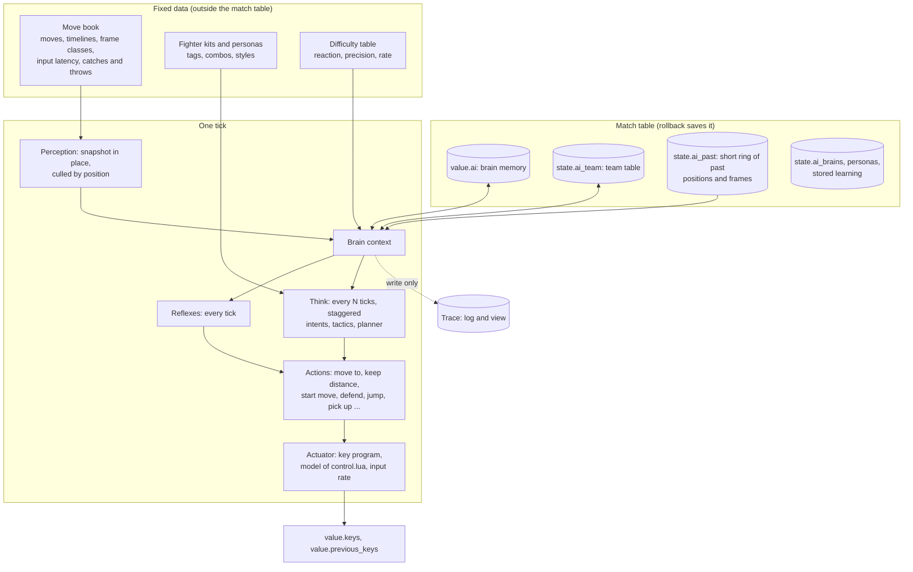

# The AI framework (plan)

This plan builds advanced computer fighters for OpenLF2: strong and human-like play, several personalities for each fighter, a development view and logs to debug a behavior, an arena for AI fights, and later learning. Phases 1 to 3 are built (2026-10-25), and docs/ai.md describes them as they are. This version of the plan comes from what the first three phases taught and from a review of their code. docs/ai-moves.md lists the moves of every fighter.

## Goals

Each goal has a measure, so that the arena and the tests can tell when it is reached.

1. Strong play. With the senses and input limits of Crazy (those of a good human player), the new brain wins at least 70% of 1v1 fights against the classic AI on Crazy for each of the ten main fighters, with a sequential test at a 5% error rate (see "Arena").
2. Personalities. Each fighter has two or three personas. In the arena, the personas of one fighter differ clearly in their move use, distance and aggression (a distance between their move histograms above a fixed limit).
3. Fair senses and hands. On Easy, Normal, Difficult and Crazy, a brain sees the fight with a reaction delay and types its keys at the human rate, with errors that the difficulty sets. Easy loses clearly to Crazy in the arena. A fifth level, Superhuman, has no limits.
4. Speed. The AI keeps to a budget for each frame that counts re-runs after a rollback, the catch-up and the server. It also keeps to it in Stage and Battle mode with many fighters.
5. Visibility. The development view shows the decisions, the scores and the active behavior of a brain while the fight runs. The log gives an agent the same facts as text.
6. Safety. The classic AI stays exact for the original's recordings and the demo. Every brain is deterministic and passes the rollback check, the simulated network and the online tests.
7. Room to learn. A brain adapts during a fight. Later, persona numbers and policies come from self-play and from recorded play, without a loss of determinism.

## Lessons from phases 1 to 3

| What we learned | What changes in the plan |
|---|---|
| A log plus a checker tool (the sentry and tools/ai_prediction_check.py) measured the prediction quickly and found 4 kinds of errors. | Every capability gets a test brain and a checker: prediction, the actuator, reflexes, the planner (Phase 4 and later). |
| `rollback.lua` skips the fields `record`, `records`, `stage`, `view`, `capture` and `last_snapshot` at any depth. A brain memory with such a field escapes the copy and the hash. | A memory validator under `--rollback-check`, and rules for the memory (see "Rules for brains"). |
| A rollback rebuilds tables in `pairs` order, so the order of a hash-part table can differ between two clients. | Brains keep dense arrays and never walk a table with `pairs` or `next`. |
| The engine changes `value.record` in place on a transform or a merge (frame_rules.lua, merge.lua, grab.lua). The memory then points into the wrong move book. | The memory keeps the record id, and a brain restarts or adapts when it changes. |
| Human keys change only on every second tick, and the combo sequences of control.lua have no timeout. The classic AI writes keys on every tick, fakes fresh presses and completes sequences at once. | An actuator with a model of control.lua and of the input rate, and the only writer of `previous_keys` (Phase 6). |
| Combat and target choice ask different questions: combat lets players of different teams hit each other, but the classic AI does not choose them as targets in Stage mode. A held weapon spares its holder's team. | Two rules in perception: `can_hurt` and `enemy`. Weapons use their holder's team. |
| Grabs, throws, turns (negative `next`), thrown items with gravity and reused slots made predictions wrong. | Phase 4 fixes them before a brain depends on them. |
| The snapshot allocates tables for every item on every tick, and a chasing ball throws it away. | A snapshot that the perception updates in place, with culling by position. |
| A trace through the setup screen cannot choose the fighters, and each run loads the installer. | `--fight SPEC` and a batch mode for the arena (Phase 5). |
| The positional arguments of `brain.tick` grow with each phase. | A brain context (version 2 of the interface). |
| Every fight is a new `match.create`. Learning and personas need a path into the match. | The match options carry the brains, the personas, the difficulty values and the stored learning. |

## Rules for brains

These rules keep brains deterministic and rollback-safe. The memory validator checks the first group under `--rollback-check`.

- The memory (`value.ai`) holds numbers, short strings, booleans and dense arrays of them. It never holds a function, a table of the move book or of the snapshot, or a field named `record`, `records`, `stage`, `view`, `capture` or `last_snapshot`. It stays under a cap: 64 numbers and 8 arrays of at most 32 entries each.
- A brain updates its arrays in place and does not make new tables on each tick.
- A brain never walks a table with `pairs` or `next`, and the order of every loop is fixed.
- A brain uses `+ - * /`, `math.floor`, `math.abs`, `math.min`, `math.max` and `math.sqrt`. It never uses `math.exp`, `math.log`, the trigonometric functions or `^` with an exponent that is not a whole number, because the C libraries of Linux and Windows can give different results.
- A brain compares whole numbers. It rounds positions and speeds before it scores, and its scores are integers.
- A brain uses only its own random stream after its start, never `engine.random`.
- A brain writes to the trace and never reads it. It never reads a timer.

## Target architecture

### Brain context (interface version 2)

`brain.tick(context)` replaces the positional arguments. The registry fills one context table for each call and reuses it, so a brain never keeps it.

- `context.state`, `context.index`, `context.self` (the fighter), `context.memory`.
- `context.world` (the snapshot), `context.me` (this fighter's entry), `context.view` (what the senses allow, see below).
- `context.book`, `context.persona`, `context.difficulty`.
- `context.act` (the action interface of the actuator), `context.log` (nil or the trace writer), `context.team` (the team table entry).
- `context.random(range)` (the brain's random stream).

Version 1 brains (`idle`, `sentry`) keep working through a small adapter until they move to version 2.

### Knowledge

The move book stays fixed data. It gets these additions:

- Turns: a negative `next` turns the fighter. The timeline marks the tick, and prediction turns the direction there.
- Catches and throws: the `catch` hit boxes, the caught frames, the throw injuries (`cpoint`) and the fall damage on landing, so that prediction can warn of a grab and plan a throw.
- Input latency: for each move and each starting class, the ticks from the first key to the move's first frame, at the fast rate and at the human rate. The sequences of control.lua have no timeout and can advance more than one step in a tick, so the latency is short at the fast rate and longer at the human rate. The drill brain of phase 6 measures it for every move.
- A weapon book: the strength entries of each weapon and the attack frames with `wpoint.attacking`, so that the planner knows the reach and damage of a swing and a throw.
- A dry run of control.lua: given a frame, held keys and fresh presses, which frame comes next. The planner uses it instead of a copy of the rules. It is the same code that the fight runs, in a mode that writes nothing.
- The books of fighters that can appear later (Stage spawns, transforms, clones) build before the fight, not inside a tick.

### Perception and senses

- The snapshot updates its entries in place on each tick, without new tables. A chasing ball does not throw the snapshot away when the slot list stays the same.
- Culling: queries use the list sorted by `x` (`by_x`) and look only within reach plus speed times the horizon.
- Two rules: `can_hurt(a, b)` follows combat (different teams, a held weapon takes its holder's team), and `enemy(a, b)` follows the classic AI's rule for targets in each mode.
- Reaction delay by structure: the match keeps a short ring of past states (`state.ai_past`: position, speed, frame, facing and hp of each character for the last 13 ticks, in arrays). A brain sees the world as it was `reaction` ticks ago and predicts the present from there. Its reflexes see the same delayed world. Only Superhuman sees the present.
- Attention: a brain follows a few sources closely and sees the rest as positions only.
- Senses key a source by slot, record id and spawn tick, so that a reused slot is a new source.

### Prediction

- Fixes: the holder's team for weapons, gravity for thrown items, drinks and baseballs, turns, and the spawn tick in the source key.
- New threats: grabs (an enemy walks into a dizzy fighter, or a catch move reaches it), throws and landings.
- Defense outcomes: what happens if the defender defends (`bdefend` against the defend points), jumps, rolls or moves in depth.
- Hit chance with latency: a planned move starts after its input latency, and a target that defends or can act in time lowers the chance.
- A "what does A do here" query through the dry run: A near an item picks it up, A while running is a run attack, A next to a dizzy enemy is a super punch.

### Decisions

A brain decides on three levels:

1. Reflexes run on every tick and stay short: defend or dodge a threat that arrives too soon to plan, escape a catch, roll after a fall, stop a move that the enemy punishes. A reflex can drop the current key program.
2. A think runs every few ticks (3 by default), with an offset for each slot. It scores the intents with integer considerations and the persona's weights, keeps the current intent unless another one is clearly better, and runs the intent's tactic.
3. A tactic is a small behavior tree (sequence, selector, condition, action). The trees are data tables, so the development view can draw them and a fighter kit can add steps. The tactic hands an action to the actuator, or asks the planner for the best move or combo.

The planner scores each candidate move with the hit chance, the damage, the risk, the mp cost and the persona, and chooses with the brain's random stream among the best ones. Combos come from the follow-ups of the move book and from the fighter kits.

The intents: engage, pressure, punish, zone, bait, evade, retreat and recover mp, get an item, use an item, help an ally, and hold a position (Stage mode).

### Actions and the actuator

Brains do not write keys. They choose actions, and the actuator turns an action into keys over the next ticks:

- Actions: move to a point, keep a distance, face a target, walk, run, start a move of the book, defend for N ticks, jump in a direction, dash, roll, pick up an item, throw, drink, wait.
- The actuator keeps a key program in the memory. It types sequences key by key inside the press windows of control.lua, and it is the only writer of `previous_keys`.
- Closed loop: on each tick, it reads `value.sequences` and the frame class. It drops the program when the fighter is hit or caught, and it reports to the brain when a move did not start.
- Input rate: the difficulty sets it. Easy to Crazy use the human rate: keys change only on the ticks where human keys change (`input_phase` 0). Superhuman can change keys on every tick. The difficulty also sets the actions per minute and the timing errors.

### Teams and Stage mode

- A team table in the match (`state.ai_team`) holds shared facts: the target of each member, the roles, the calls for help, and an `order` entry for each member. Brains write it during their think, and other brains read it on the next tick, so the order of the brains does not change a result. Orders from human players to AI allies (follow me, attack my target) are a later feature. The `order` entry keeps a place for them, and phases 4 to 12 do not build them.
- Stage mode: a setup option "Stage AI" chooses Classic (the default, the original's feel) or New. With New, the enemies of a stage get a brain and a persona by record id and difficulty (Grunt, and Elite for bosses), and the allies of the players get their own defaults.
- Level of detail: a brain far from every threat and every target runs only its reflexes and a cheap think. This keeps Stage and Battle mode in the budget.

### Personas, difficulty and fighter kits

- A persona is a data table: integers from 0 to 100 for `aggression`, `patience`, `risk`, `mp_thrift`, `combo_greed`, `defense`, `mobility`, `items`, `teamwork` and `adapt`, a preferred `range` in pixels, a category `focus` (nearest, weakest, strongest, last attacker), and move preferences by tag.
- The difficulty is a separate table: reaction ticks, attention, distance noise, timing errors, input rate, actions per minute, and whether the planner sees the full move book. It has five rows: Easy, Normal, Difficult and Crazy (the classic names, with human limits from weak to strong), and Superhuman (no limits). Superhuman uses the game rules of Crazy. The setup screen lists it after Crazy, and with classic brains it plays like Crazy.
- A fighter kit (scripts/base/ai/fighters/NAME.lua) adds tags, combos, special rules and the personas of the fighter. A mod (`--mod`) can register a brain and add or replace a kit. A network game shares them through script sharing, so every computer runs the same brain. Players change personas through a mod, not through separate data files.

A first list of personas, which the arena tunes later:

| Fighter | Personas |
|---|---|
| Davis | Brawler (`DvA` then `D^A` up close), Shoto (balls and an uppercut against jumps), Wild (runs and jumps) |
| Firen | Pyro (burn run and flames), Zoner (balls from a distance), Bomber (explosion when surrounded) |
| Freeze | Controller (whirlwind and ice column), Glacier (defends with the ice sword), Zoner |
| John | Medic (heals and shields the team), Disc (disks and biscuits from a distance) |
| Henry | Sniper (arrows, keeps the distance), Bard (flute against groups) |
| Rudolf | Assassin (hides, clones, comes in from the side), Duelist (jump sword) |
| Louis | Bruiser (thousand-foot kick and catches), Armored (goes for the transform to Louis EX) |
| Dennis | Kicker (whirlwind kick and many foot), Chaser (chase balls) |
| Woody | Tiger (flying crash and dashes), Teleporter (teleports to the enemy or to allies) |
| Deep | Swordsman (sword combos), Dasher (dash sword) |
| Louis EX, Firzen, Julian | Boss (heavy pressure with the strongest moves), and one more style each |
| Bandit, Hunter, Mark, Jack, Sorcerer, Monk, Jan, Knight, Bat, Justin | Grunt (Stage enemy), Elite (stronger and smarter) |

## From the setup to the fight

- The match options carry `ai_brains` (by slot), the personas, the difficulty row, and the stored learning of earlier fights. `match.create` copies them into the match table, so every computer of a network game has them.
- The setup (base/game/setup) gets a brain and a persona for each computer slot, through commands like every other setup value. The server keeps them in `last_setup`. The persona list of a slot starts at Random: the brain picks one of the fighter's personas with its own random stream at its start, so every computer picks the same one.
- The default brain of a computer slot is `classic` until the tactician passes the arena test of phase 8. Then the default becomes the tactician with Random persona, and `classic` stays in the list.
- A local fight takes `--ai-brain` and `--fight` as today. A network session takes only the server's setup.
- Live edits of persona numbers in the development view work in local fights only. They become inputs (`=ID:N`) that change the copy in the match table. A network game shows the numbers but does not change them.
- Recordings: OpenLF2 adds its own block to a recording with the brain, persona and version of each computer slot. A replay with another version of a brain stops with a clear message. Until the block exists, a fight with a new brain makes no recording.

## Development view

The world layer is built (docs/ai.md). The next layers read "brain frames": when the view is on, each brain writes a short record of its decision on each think to the trace (intent scores, the active tree path, the candidate moves, the key program). The trace keeps the last 300 ticks for each fighter and drops ticks that run again.

- Inspector (a panel of base/ui/panels): the fighter, its brain, persona and difficulty, the intent scores as bars with the parts of the chosen score, the behavior tree with the state of each step, the candidate moves with hit chance, value and risk, the key program, and the last 30 decisions with their reasons.
- Decision timeline: a row for each AI fighter with its intent over the last 10 seconds, and marks for hits dealt and taken.
- World layer additions: the target line, the intent above the head, the predicted hit boxes of the planned move, the goal point.
- Controls: F1 pauses. F8 moves the fight one tick forward while it is paused and the view is on. In that case the flow takes the key, so the match does not see F8 (the original's function key). The game speed gives slow motion, and a click selects a fighter.
- An HTML viewer (tools/ai-viewer.html) loads an AI log of a whole fight and shows the decision timeline, the intent scores and the behavior tree of each tick, to study a fight after it ended and to share it. `--ai-log ... frames` writes the brain frames to the log for it.

## Logs, metrics and tests

- The log keeps one line for each change. The events: `start`, `target`, `intent`, `move` (with the hit chance and the risk), `result` (hit, blocked, missed, punished), `reflex`, `threat`, `hurt` (with the cause), `sum`, and `ai-result` at the end of a fight.
- tools/test-ai.sh runs the AI tests in one command:
    - The classic baseline: the VS traces give the same description as a stored copy.
    - The rollback check with `rollback.interval` 9, and the memory validator.
    - `--net-sim` with each brain.
    - The move book against tools/lf2_moves.py.
    - The checkers of each capability (prediction, actuator, reflexes) with their limits.
    - A short arena run.

## Arena

- `--fight SPEC` starts a fight at once: mode, background, fighters, teams, brains, personas, difficulty, a time limit and a seed. For example `vs:davis/tactician/brawler,firen/classic;time=3600`.
- A batch mode runs many fights in one process (`--fights N` with consecutive seeds), so the installer loads once, and it skips the drawing.
- Each fight runs with both sides mirrored (sides and slots swapped) to cancel the start position. The time limit is 3600 ticks (2 minutes). At the limit, the side with more hp left wins, and equal hp is a draw (half a point).
- tools/ai-arena.py runs batches in parallel processes, reads the `ai-result` lines, and stops a comparison with a sequential test (SPRT) when the result is clear. It prints win rates with their margin, damage per minute, move use for each persona, and the AI time.
- `engine.network_time` (a timer for the arena and the view only) measures the AI time for each tick.

## Speed

- A budget for each frame: all brains together use at most 4 ms in a frame of a release build, including the re-runs after a rollback (up to 20 ticks), the catch-up and the server. A single think stays under 0.5 ms.
- Level of detail, in-place snapshots, culling, staggered thinks and capped memory keep the AI in the budget.
- The arena reports the AI time, and tools/test-ai.sh fails when a fixed scenario goes over its limit.

## Learning

1. During a fight: an opponent model (counts of how each enemy acts in a few situations) and move results (hits, misses and punishes of each move). Both are integer arrays in the memory.
2. Across fights: the match options carry a stored learning block for each fighter and persona, and the next fight starts from it. Local games keep it in config.json. A network session keeps it on the server, like `last_setup`, so every computer starts from the same data.
3. Tuning: an optimizer in tools/ changes persona numbers, runs the arena and keeps the numbers that win more. The result is a persona file.
4. Imitation: recorded human play (the keys and the snapshots of a fight) trains the choice of intents and moves.
5. Self-play: tools in tools/ run the headless game in batches. The game uses `rollback.save` and `rollback.restore` to reset and to branch a fight. A trained network runs in the game with integer weights and fixed-point sums that stay below 2^53.
6. No brain runs outside the game. A program outside the game does not drive a fighter (decision of 2026-10-25), so training happens through batches of the game and through files of numbers that the scripts load.

## Engine changes

1. Done: `--ai-log`, `--ai-brain`, `--ai-book`, `--ai-view`.
2. `--fight SPEC` and `--fights N` (the arena).
3. A timer for the arena and the view: `engine.network_time` (milliseconds with a fraction) serves. The rules forbid it in decisions.
4. Menu elements for the inspector: a tree node, a table, a line plot. Until they exist, the view uses text, bars and selectables.

Older engines get the scripts through script sharing, so the scripts check a new function before they use it (`if engine.clock then`).

## Remaining work

Each phase ends with tests that pass. No phase changes the classic AI.

### Phase 4: hardening

- Fix the prediction: the holder's team for weapons, gravity for thrown items, turns, and the spawn tick in the senses key.
- The two rules `can_hurt` and `enemy`.
- The memory keeps the record id. A brain restarts when the record changes, and when the computer takes a human fighter again.
- The memory validator under `--rollback-check`, and the rules for brains in AGENTS.md and in brains.lua.
- The snapshot in place, culling by `by_x`, and no rebuild after a chasing ball.
- The books of Stage spawns, transforms and clones build before the fight.
- tools/test-ai.sh with the checks that exist today.
- Tests: the sentry's exact rate does not go down, tools/test-ai.sh passes, and a Stage mode trace with sentries passes the rollback check.
- Status: built. The sentry still predicts 133 of 143 hits exactly. tools/test-ai.sh passes (classic descriptions, rollback every 9 ticks in VS and Stage mode, `--net-sim`, the move book, the prediction rate), and so does tools/test-online.sh. Not done: the snapshot is still filled again after a chasing ball (from the pool, without new tables), and grab and throw threats wait for phase 6 (the control model).

### Phase 5: the arena

- `--fight SPEC`, `--fights N`, the time limit, mirrored sides, no drawing in batch mode, `engine.clock`, the `ai-result` lines.
- tools/ai-arena.py with parallel processes and SPRT.
- Tests: classic against classic on the same fighter gives about 50%. A batch of 100 fights gives the same results as 100 single runs.
- Status: built. `--fight SPEC --fights N` runs one whole fight per frame without drawing (base/game/arena), so 400 fights take about 6 s on all cores of this computer (debug build). Fight K starts the engine's random streams from its own number (a Park-Miller table), so a batch and single runs (`first=K`) give the same fights. tools/ai-arena.py runs chunks in parallel and prints the score with its 95% margin, the damage per minute, the length, the AI time and the move use, and `--sprt LOW,HIGH` stops early. Measured: classic Davis against classic Davis without mirroring scores 0.505 +- 0.049 over 400 fights (no slot advantage), classic Davis beats classic Firen 0.804 +- 0.050 (SPRT stop after 240 fights), and the classic AI costs 12 to 19 us for each fighter and tick (debug build). `engine.network_time` already has a fraction of a millisecond, so the arena measures with it and needs no `engine.clock`.

### Phase 6: the actuator and the control model

- The actions, the key programs, the closed loop, the input rate, the dry run of control.lua, the input latency in the move book.
- The test brain `drill`: it starts every move of the book from each starting class and logs whether the move started on the predicted tick.
- Tests: the drill starts all special moves of all fighters, at the fast rate and at the human rate. The checker reports each move that fails.
- Status: built.
    - base/ai/actuator types key programs (masks for each sample) at the rate of base/ai/difficulty (the human rate on the four classic levels, every tick on Superhuman), with a limit of key changes a second and a timing error. It is the only writer of a brain's keys and previous keys, and it releases a held key before it presses it again.
    - Closed loop: the sequences of base/game/control have no timeout, so a sequence can still wait after an earlier Defend, and a fresh Defend then resets it. The actuator reads `value.sequences` and types only the missing keys. The same rule starts a combo by accident (for example up, then attack, long after a Defend), for humans too.
    - Latency: the human rate needs 4 ticks for a full input (D, direction, key on three human input ticks), the fast rate 1 tick (D, then direction and key together). A sequence that already waits needs less.
    - The test brain `drill` types every special move of its book from standing and from a jump. tools/ai_drill_check.py: all special moves of all 23 fighters start at both rates, except Louis's transform (it needs hp of 177 or less) and Rudolf's transform (it needs a fighter that he caught before).
    - Prediction now follows catches (kind 3, and kind 1 only on a dizzy fighter) as threats of the kind `catch`.
    - Not built: a dry run of control.lua. The drill checks the actuator against control.lua for every move instead. The planner of phase 8 gets a small table of what Attack does in each state (punch, run attack, jump attack, pick up, super punch).

### Phase 7: the brain context, reflexes and the delayed view

- Interface version 2, the past ring (`state.ai_past`), the difficulty table, the reflexes.
- The test brain `guard`: it only defends and dodges. A checker counts the threats that it blocked or avoided.
- Tests: on Crazy, the guard blocks or avoids most hits that it can see in time. On Easy, it blocks clearly fewer. Rollback and network tests pass.
- Status: built.
    - Interface 2: `brain.tick(context)` with one reused context (state, index, self, memory, scan, world, me, view, book, row, persona, log, random). The test brains `idle`, `sentry` and `drill` keep interface 1.
    - The delayed view: when a brain other than classic plays, the match records the last 13 ticks of every character in `state.ai_past` (10 numbers each), and `perception.view` shows the other characters as they were `reaction` ticks ago. Flying objects and weapons stay in the present. `view.delay` tells prediction how old the view is.
    - base/ai/reflex: defend toward the source when the hit comes within 6 ticks, step aside in depth from a ball or from a hit that a defend cannot stop (a catch, `bdefend` of 61 or more, or defend points that reach 31 with the hit), and jump when there is no time.
    - The test brain `guard` only answers threats. tools/ai_reflex_check.py: on Crazy (a reaction of 4 ticks), 30 of 32 answers worked (94%), on Superhuman 136 of 175 (78%), on Easy (12 ticks) the guard sees no threat in time. Most hits on a pure guard come from punches that hit 3 ticks after their start: no reflex sees them in time, so a brain must defend early when an enemy comes near (phase 8).

### Phase 8: the first strong brain

- The brain `tactician`: intents, tactics as behavior trees, the planner, combos from the move book. One generic persona for all fighters.
- Tests: in the arena, with the senses and input limits of Crazy, the tactician beats classic on Crazy in at least 70% of the fights for each of the ten main fighters (SPRT). It keeps to the speed budget.

### Phase 9: the development view

- Brain frames in the trace, the inspector, the behavior tree view, the decision timeline, F8 for one tick forward, the selection by click, live edits in local fights.
- The HTML viewer for AI logs (tools/ai-viewer.html) and the `frames` detail of `--ai-log`.
- Tests: the same trace gives the same fight with the view on and off. tools/test-online-ui.sh opens the view in a session. The viewer shows a log of the arena.

### Phase 10: setup, sessions and recordings

- A brain and a persona (Random by default) for each computer slot on the setup screen, through server commands and `last_setup`. The Stage AI option, and the defaults for Stage enemies and allies. Superhuman in the difficulty list.
- OpenLF2's recording block with the brain, persona, difficulty row and script version of each computer slot.
- Tests: a session with tactician computers passes tools/test-online.sh scenarios. A recording of a tactician fight replays the same.

### Phase 11: fighter kits, personas and team play

- A kit for every fighter with the personas of the table, the difficulty rows, the team table, level of detail for Stage and Battle.
- Tests: the arena shows different move use for the personas of a fighter. Easy loses clearly to Crazy. A full Stage run with tactician enemies keeps to the budget.

### Phase 12: learning during and across fights

- The opponent model, the move results, the stored learning block in the match options.
- Tests: against a scripted opponent that always jumps over balls, a Zoner uses fewer balls in the second half of a fight, and starts the next fight with that knowledge.

### Phase 13: learning from data (later)

- The persona tuner, the imitation data from recorded play, self-play batches, integer networks in the scripts.

## Risks

- Strength against fairness: a brain with perfect senses wins easily but does not feel human. The arena reports both the win rate and the fairness settings, and the difficulty rows decide.
- Cost in network play: re-runs multiply the AI cost. Level of detail and the per-frame budget are the answer, and tools/test-ai.sh measures it.
- Hidden state: a field that escapes the rollback copy desyncs only in rare cases. The validator and the rules prevent it, and `--net-sim` runs with every brain.
- Platform math: numbers with a fraction in decisions can differ between Linux and Windows. Integer scores and the banned functions prevent it.
- Mods: a mod with new data gets a move book from its frames, but no kit. A generic persona covers it.

## Decisions

The owner decided these points on 2026-10-25. The sections above follow them.

| Question | Decision |
|---|---|
| The fairness of the strongest levels | Easy, Normal, Difficult and Crazy have human limits. A fifth level, Superhuman, has no limits. |
| The input rate of brains | Set by the difficulty: the human rate on the four classic levels, every tick on Superhuman. |
| The reaction delay | A delayed view of the world from a short ring of past states. Only Superhuman sees the present. |
| The default brain | `classic` until the tactician passes the arena in phase 8. Then the tactician with a Random persona. |
| Recordings | OpenLF2's own recording block with the brain, persona, difficulty row and version of each computer slot (phase 10). |
| Personas of a computer slot | A choice on the setup screen, with Random as the default. |
| Stage mode | A setup option "Stage AI": Classic (default) or New. |
| Learning across fights | config.json in local games, the server in network sessions. |
| The next phases | Phase 4 (hardening), then phase 5 (the arena). |
| The inspector | In the game, and an HTML viewer for AI logs. |
| One tick forward | F8 while paused with the view on. |
| Orders to AI allies | Later. The team table keeps an `order` entry for them. |
| The difficulty levels | The classic four and Superhuman. |
| Live edits of personas | Local fights only. |
| The arena fight | 3600 ticks, hp decides at the limit, a draw counts half, mirrored sides. |
| Who adds brains and personas | Mods (brains and fighter kits), shared by script sharing. No separate persona files, and no brains outside the game. |
