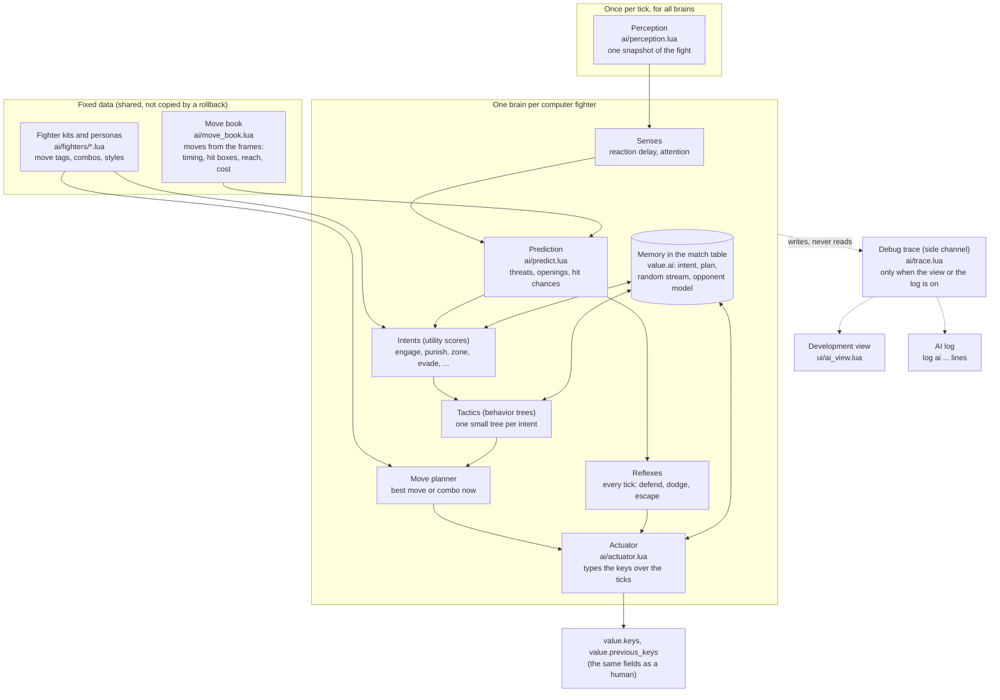

# The new AI framework (plan)

This plan replaces the single AI routine of the original (docs/ai.md) with a framework for advanced computer fighters. The framework gives each fighter several personalities, a view for developers that shows what the AI thinks, and logs that an agent can read to debug a behavior. Learning across matches comes later, but the framework keeps a place for it. docs/ai-moves.md lists the moves that the new AI uses.

## Goals

1. Strong play: the AI uses the frame data (hit boxes, start-up, reach, cost) of every move, so it hits when a hit is possible and does not attack when the attack loses.
2. Personalities: each fighter has two or three styles of play, and each style is a set of numbers in a data file.
3. Fair senses: the AI sees the fight with a reaction delay and a limit on its attention, and it types its keys like a player. The difficulty sets these limits.
4. Speed: the AI costs at most 0.1 ms for each computer fighter and tick on average, also in Stage mode with many enemies and during a rollback.
5. Visibility: a development view shows the decisions, the scores and the active behavior while the fight runs, and a log shows the same facts as text.
6. Safety: the classic AI stays exact, so the original's recordings and the demo do not change. The new AI is deterministic and passes `--rollback-check`, `--net-sim` and tools/test-online.sh.
7. Room to learn: the AI can adapt during a match, and later the numbers and policies can come from self-play.

## Limits from the engine

These facts of the engine shape every decision of the plan:

- The fight is a lockstep simulation (all computers run the same ticks). Each computer of a network game runs the AI of every computer fighter, and all of them must get the same keys. The AI can use only the fight state and its own random stream.
- A rollback saves and restores only the match table. All memory of the AI must live in the match table, and it must be small, because each save copies the whole table (base/game/rollback).
- A client in a network game runs some ticks more than once. The AI must be cheap, and its debug output must not count a tick twice.
- The hash of the fight covers all of the match table. Numbers with a fraction are a risk across platforms (for example a fused multiply-add on ARM64). The AI uses integers for its scores, like the original's rules.
- The original's recordings store only the keys of the players and run the classic AI again. A new AI in a recording needs its own data, or the recording stops (like `ai_control` today).

## Where the brain runs

The brain (the part of the AI that decides for one fighter) can run in two places.

| | In the simulation (default) | Outside the simulation, as a pilot (later) |
|---|---|---|
| Where | inside `match.step`, on every computer | on one computer, after the frame, like a player |
| Output | the keys of the fighter, on the same tick | keys that go into the input, like a human's keys |
| Determinism | required: integers, its own random stream | not required: it can use any math |
| Cost | paid again on each rollback and on each computer | paid once |
| Network | no dependency on one computer | the fighter waits when that computer drops |
| Use | all computer fighters, Stage enemies, the demo | heavy models, external training, tests that drive a player |

The plan uses the simulation for all brains. The interface of a brain is the same in both places, so a pilot host can come later without a change to the brains.

## The parts of the framework



### Move book

The move book is the knowledge of the AI. It reads the frames of each fighter record once, when the record loads, and keeps the result on the record. The record is fixed data, so a rollback does not copy it and the hash does not include it.

For each move, the book keeps:

- The input and the frames where the input works (the same facts as tools/lf2_moves.py, but complete).
- The cost in mp and hp, and the cost of a held move for each frame.
- A timeline for each tick of the move: the hit boxes relative to the fighter (with damage, `fall`, `bdefend`, effect, `zwidth`), the body boxes (no body box means that the fighter cannot be hit), and the movement (`dvx`, `dvy`, `dvz`).
- The start-up (ticks to the first hit), the active ticks, the recovery (ticks to a frame where the fighter can act again), and the follow-ups (`hit_a`, `hit_j`, `hit_d` and combo fields inside the move).
- The projectiles: the object, its speed, its hit box, its life, and whether it chases.
- Tags from the analysis: close, ranged, anti-air, breaks defense, knocks down, catch, heal, movement, transform.

The book also maps every frame of a fighter to a short class: free, moving, attacking (with the move), defending, in the air, hurt, lying, dizzy, caught, catching, and the ticks until the fighter is free. Prediction needs this class for every fighter on the field.

### Perception

Perception builds one snapshot of the fight on each tick, before the first brain runs. It extends `ai.prepare`, which already scans the items once. The snapshot is a local table of the tick and never goes into the match table.

For each fighter, ball and item, the snapshot holds the position, the speed, the team, the frame class, the hit boxes and body boxes in world coordinates, the hp, the mp and the ticks until the fighter is free. It also sorts the items by `x`, so that a brain can find its near neighbors without a scan of all items.

### Senses

The senses limit what one brain knows. They make the difficulty and the personality fair.

- Reaction delay: a brain notices that an enemy starts a move only after its reaction time (for example 6 ticks on Easy and 2 on Crazy). The memory keeps the frame and the tick when it last saw each tracked enemy start a move.
- Attention: a brain follows only a few fighters closely (the target, the nearest threats, its allies in need). Other fighters are only positions.
- Noise: a brain can misjudge a distance by a few pixels, from its own random stream.

### Prediction

Prediction answers the questions of the brain with the move book and simple motion (constant speed, and the move timeline of a fighter that attacks):

- Threats: which hit box or ball reaches me, in how many ticks, and how much damage it does. It also answers: what happens if I stay, if I defend, if I jump, or if I move in depth.
- Openings: which enemy is not free for how many ticks (recovery, lying, dizzy, broken defense).
- Hit chance: if I start move M now, does it hit target T, on which tick, and can T defend or escape before that tick.
- Risk: if move M misses, how many ticks am I open, and can the enemy hit me in that time.

Each answer is a short loop over the ticks of one move timeline. The brain asks only about a few candidate moves and one or two targets, so the cost stays small.

### Memory

The memory of a brain is the table `value.ai` on its fighter, in the match table. It holds numbers and short arrays only:

- The brain and the persona (two short names), and the version of the persona.
- The random stream of the AI (one integer, a Park-Miller generator, so that the numbers stay exact in a double). The AI does not use `engine.random`, so a change to the AI never changes the random items, the drops or the stage of a fight.
- The current intent, the tick when it started, the active node of the tactic, and the planned move or combo.
- The key program of the actuator (the keys of the next ticks).
- The tracked enemies (frame and tick of the last move start).
- The opponent model and the move results (counters, for learning during the match).

### Decisions

A brain decides on three levels. A higher level runs less often:

1. Reflexes run on every tick. They are short rules for danger that is near: defend against a hit box that arrives in fewer ticks than the reaction time allows, jump or move in depth away from a ball, press keys to escape a catch, roll after a fall. A reflex can stop the current plan.
2. Intents run on each think (for example every 3 ticks, with an offset for each slot). Each intent gets a score from weighted considerations, for example "the target is open for 12 ticks" or "my mp is low". The brain keeps its intent for a few ticks unless another intent is clearly better, so it does not change its mind on every think. The intents are: engage, pressure, punish, zone, bait, evade, retreat and recover mp, get an item, use an item, help an ally, and hold a position (Stage mode).
3. Tactics run the intent. Each intent has a small behavior tree (a tree of steps: a sequence runs its children in order, a selector tries them until one works, a condition tests a fact, an action does one thing). The trees are data tables, so the development view can draw them and a fighter kit can add its own steps.

The move planner picks the move or the combo for an action of a tactic. It scores each candidate with the expected damage (the hit chance times the damage), the risk, the mp cost and the personality, and it chooses with the AI's random stream among the best ones. Combos come from the follow-ups of the move book and from the fighter kits, for example Davis's `DvA` then `D^A`.

### Actuator

The actuator turns a decision into keys over the next ticks. It holds a key program in the memory, for example "defend on tick 0, forward on tick 1, attack on tick 2" for `D>A`.

- It types special moves key by key, inside the press windows of base/game/control. A difficulty can allow the classic shortcut (the sequence marked complete).
- It can follow the human input rate (keys change only on every second tick, like the keys of a player).
- It limits the key changes per second (the actions per minute of the persona).
- It adds timing errors from the random stream, by the precision of the persona.

### Personalities and difficulty

A persona is a set of integers from 0 to 100, plus a few distances in pixels. The personality and the difficulty are separate: the personality says what the AI likes, and the difficulty says how well it plays.

| Number | Meaning |
|---|---|
| `aggression` | how much it likes to go in and attack |
| `patience` | how long it waits for an opening before it forces one |
| `risk` | how much damage it accepts to land a hit |
| `range` | the distance that it likes to fight from, in pixels |
| `mp_thrift` | how much mp it keeps for the strong moves |
| `combo_greed` | how often it adds a follow-up instead of a safe stop |
| `defense` | how often it defends or dodges a threat that it sees |
| `mobility` | how often it runs, jumps and dashes |
| `items` | how much it likes weapons and drinks |
| `teamwork` | how much it helps allies and attacks the same target as they do |
| `focus` | how it picks a target: the nearest, the weakest, the strongest, or the one that hit it last |
| `adapt` | how fast it changes its play from what it learns in the match |

The difficulty sets the reaction time, the attention, the noise, the precision, the actions per minute, and whether the planner uses the full move book. The classic difficulties (Easy, Normal, Difficult, Crazy) map to four sets of these values.

### Fighter kits

A kit is one data file for each fighter (scripts/base/ai/fighters/davis.lua and so on). It adds what the frames do not say:

- Tags for moves, for example "Davis `D^A` is an anti-air move" or "John `D^J` heals an ally".
- Combos and set-ups that the planner can use.
- Rules for special cases, for example the steering of Firen's burn run or the end of Rudolf's hide.
- The personas of the fighter.

A first list of personas (the arena tunes the numbers later):

| Fighter | Personas |
|---|---|
| Davis | Brawler (`DvA` then `D^A` up close), Shoto (balls and an uppercut against jumps), Wild (runs and jumps) |
| Firen | Pyro (burn run and flames), Zoner (balls from a distance), Bomber (explosion when surrounded) |
| Freeze | Controller (whirlwind and ice column), Glacier (defends with the ice sword), Zoner |
| John | Medic (heals and shields the team), Disc (disks and biscuits from a distance) |
| Henry | Sniper (arrows, keeps the distance), Bard (flute against groups) |
| Rudolf | Assassin (hides, clones, comes in from the side), Duelist (jump sword) |
| Louis | Bruiser (thousand-foot kick and catches), Armored (goes for the transform to Louis EX) |
| Dennis | Kicker (whirlwind kick and many foot), Chaser (chase balls) |
| Woody | Tiger (flying crash and dashes), Teleporter (teleports to the enemy or to allies) |
| Deep | Swordsman (sword combos), Dasher (dash sword) |
| Louis EX, Firzen, Julian | Boss (heavy pressure with the strongest moves), and one more style each |
| Bandit, Hunter, Mark, Jack, Sorcerer, Monk, Jan, Knight, Bat, Justin | Grunt (Stage enemy), Elite (stronger and smarter) |

## Brain interface

A brain is a module in scripts/base/ai/brains/. The registry (scripts/base/ai/init.lua) knows the brains by name, and a mod can add a brain with an extension (`--mod`).

```lua
local brain = {name = "tactician", version = 1}

-- Called once when the fighter enters the fight. Returns the memory (numbers and short arrays only).
function brain.start(fighter, persona, seed) end

-- Called on every tick. `view` is the snapshot through this brain's senses, `book` the move book of its record,
-- `act` the actuator, `trace` the debug side channel (a function that does nothing when the view and the log are off).
function brain.tick(view, memory, book, persona, act, trace) end

return brain
```

The existing AI becomes the brain `classic`, a thin wrapper around `ai.control` that does not change it. The match calls the brain of each computer fighter in `read_input`, where `ai.control` runs today. A slot without a brain name uses `classic`, so the existing modes, recordings and the demo do not change.

The match setup gets a brain and a persona for each computer slot (base/game/setup, the setup screen). In a network game, the choice goes through the server's commands like every other setup value, so every computer runs the same brain.

## How to change the new AI

The framework puts each kind of change in one place:

| Change | Place |
|---|---|
| A new style for a fighter | a persona in the fighter's kit (scripts/base/ai/fighters/NAME.lua): numbers only |
| A combo, a move tag, a special case of one fighter | the fighter's kit |
| A new behavior for all fighters | a step or a tree in the tactics (scripts/base/ai/tactics/) |
| A new reason to choose an intent | a consideration in the intents (scripts/base/ai/intents.lua) |
| A new kind of brain | a module in scripts/base/ai/brains/, or a mod that adds one |
| The difficulty | the difficulty sets (scripts/base/ai/difficulty.lua) |

To test a change:

1. Run a headless fight with `--ai-log` and a fixed `--seed`, and read the log at the tick of the behavior.
2. Run the arena for the fighter against the old version of the brain, and compare the win rate and the move use.
3. Run the fight with `--rollback-check` and `--net-sim`. The failures must be 0.
4. Run tools/test-online.sh after a change to the setup or to the brain interface.

## Development view

The development view shows what the AI thinks. It is local to this computer and only reads the debug trace. It never changes the fight, so the same trace gives the same fight with the view on and off.

- Switch: a flag (`--ai-view`) and a switch on the Display page of the settings menu, off by default.
- Data: when the view is on, each brain writes its decisions to the debug trace: a ring buffer of the last 300 ticks for each fighter, outside the match table. A tick that runs again after a rollback overwrites its entry.

The view has these parts:

1. World layer (drawn in the render area of the camera view):
    - The hit boxes and body boxes of all fighters and balls.
    - For the selected AI fighter: a line to its target, the name of its intent above its head, the predicted hit boxes of its planned move, the reach of its best moves, its goal point.
    - Threats: the ticks to impact next to each hit box that is on its way to the fighter.
2. AI inspector (a panel of base/ui/panels):
    - The fighter, its brain, its persona and its difficulty values.
    - The score of each intent as a bar, with the parts of the score of the chosen intent.
    - The behavior tree of the current tactic, with the state of each step (running, done, failed) in colors, and the active path.
    - The candidate moves: hit chance, value, risk, mp.
    - The key program of the actuator, and the opponent model.
    - The last 30 decisions with their reasons.
3. Decision timeline (a panel like the input timeline): a row for each AI fighter with its intent over the last 10 seconds in colors, and marks for hits dealt and taken.
4. Controls: F1 pauses (it does today), a key for one tick forward in a pause, the game speed for slow motion, a click on a fighter to select it. In a local game, the inspector can change the persona numbers during the fight. In a network game it only shows them, because a change makes the computers differ.

## Logs for agents

The AI log gives an agent (and a developer) the same facts as text. An agent runs a headless fight, reads the log and finds the tick where a behavior went wrong.

- Switch: `--ai-log` (all AI fighters) or `--ai-log SLOTS`. Each line is a `log ai ...` action of the scripts, so the engine prints it on its output (the path of the server's log lines).
- Content: one line for each change, not one line for each tick. For example:

```text
ai t=812 s=11 f=davis p=brawler ev=intent from=engage to=punish why=open:12,dist:64 score=730/510
ai t=812 s=11 ev=move m=many_punch/270 hit=72 value=410 risk=90
ai t=815 s=11 ev=reflex kind=defend threat=firen_ball/s=0 impact=4
ai t=829 s=11 ev=result m=many_punch/270 dealt=45 blocked=0
ai t=840 s=11 ev=sum intent=pressure target=0 hp=310 mp=125 dist=140
```

- Only final ticks: in a local fight every tick is final. In a network fight, the log writes a tick when the client confirms it, from the debug trace, so a rollback does not write a tick twice.
- The fight description (`describe`) gets a short `ai{...}` part for each AI fighter: brain, persona, intent, target, planned move.
- A summary at the end of a fight: `ai-result` lines with the winner, the damage, the moves used with their hit rates, and the AI time per tick.

## Arena

The arena runs many AI fights without a window and counts the results. It tests the strength, the personality and the speed of a brain, and later it is the base of the learning.

- tools/ai-arena.py starts many headless games at the same time (like tools/test-online.sh), each with a seed and a fight, for example `davis:brawler vs firen:classic`.
- The engine starts the fight at once from a flag (`--fight SPEC`), without a trace through the setup screen.
- The tool reads the `ai-result` lines and prints win rates with a margin of error, damage per minute, the use of each move for each persona, and the AI time per tick.
- Tests that use the arena: the new brain must beat `classic` on Crazy, the personas of one fighter must use their moves in a clearly different way, and the time must stay in the budget.

## Speed

- The budget is 0.1 ms on average for each computer fighter and tick, and 0.5 ms for one think, in a release build.
- Perception and the move book run once (per tick and per record), not once per brain.
- The thinks of the brains spread over the ticks (a think every 3 ticks, with an offset for each slot). Reflexes run on every tick but are short.
- The memory stays small, because a rollback copies it. The work tables of a tick live in the snapshot and are used again on the next tick.
- The hot loops use numeric `for` loops, not `pairs`, so that LuaJIT can compile them.
- The arena and the development view measure the time with a timer of the engine that only they use. A decision never reads the time.

## Learning

During a match (in the plan):

- The opponent model counts how each enemy acts in a few situations, for example "jumps when a ball comes" or "defends after my run". The intents and the planner use the counts, by the `adapt` number of the persona.
- The move results count hits, misses and punishes for each move, so the planner uses less of a move that does not work against this enemy.
- All counters are integers in the memory, so the rollback and the hash cover them.

Across matches (later):

1. Tuning: an optimizer in tools/ (for example an evolution strategy) changes the numbers of a persona, runs the arena, and keeps the numbers that win more. The result is a persona file in the scripts.
2. Learned policies: an outside trainer runs the headless game as an environment through a bridge (keys in, snapshot out) and trains a small network by self-play. The game runs the network with integer weights in a data file, so every computer gets the same result. The network profile (the hash of the scripts) covers the file.
3. Heavy models that cannot be deterministic run as a pilot outside the simulation.

## Engine changes

The framework needs few changes to the engine. Each one is small:

1. Flags for the scripts: `--ai-view`, `--ai-log`, `--fight SPEC`.
2. Menu elements for the inspector: a tree node, a table and a line plot (new UiKind values). Until they exist, the view uses text, bars and selectables.
3. A timer for the arena and the view (`engine.clock`), which the rules forbid in decisions.
4. Later: the bridge for an outside trainer (`--ai-bridge`).

Older engines get the scripts through script sharing. The scripts check a new function before they use it (`if engine.clock then`).

## Implementation plan

Each phase ends with tests that pass. A phase changes the classic AI in no way, so the replays and the demo stay as they are.

### Phase 1: the frame of the framework

- The brain registry, the brain `classic` (a wrapper), the call in `read_input`, `value.ai` in the match table, the AI random stream.
- The debug trace, `--ai-log`, the `ai{...}` part of the description.
- A brain `idle` for tests (it only walks to the target).
- Tests: the existing traces give the same description as before. A fight with the brain `idle` passes `--rollback-check` with `rollback.interval` 9 and `--net-sim`.

### Phase 2: the move book

- scripts/base/ai/move_book.lua: the timelines, the frame classes and the tags of every move, cached on the record.
- A command that prints the book of one fighter, and a test that compares it with tools/lf2_moves.py.
- Tests: the book of every fighter builds without errors, and the build time of all records stays under 50 ms.

### Phase 3: perception and prediction

- The snapshot of the tick, the senses, the threats, the openings, the hit chance and the risk.
- The first world layer of the development view: hit boxes, body boxes, threats with their ticks to impact.
- Tests: in fixed situations (a trace that sets up a ball at a known distance), the prediction gives the tick of impact that the fight shows.

### Phase 4: the first strong brain

- The brain `tactician`: reflexes, intents, behavior trees, the move planner and the actuator. It plays every fighter with the move book and the tags only, with one generic persona.
- The arena (tools/ai-arena.py and `--fight`).
- Tests: `tactician` wins at least 70% of the 1v1 fights against `classic` on Crazy over 50 seeds, for each of the ten main fighters. It stays in the time budget. It passes the rollback and network tests.

### Phase 5: the development view

- The AI inspector, the behavior tree view, the decision timeline, one tick forward in a pause, the selection of a fighter by click.
- Changes to persona numbers during a local fight.
- Tests: the same trace gives the same fight with the view on and off. tools/test-online-ui.sh gets a check with the view open in a session.

### Phase 6: fighter kits and personas

- A kit for every fighter, with the personas of the table above. The setup screen gets the brain and the persona of each computer slot.
- Difficulty sets for the four classic difficulties.
- Tests: the arena shows a clear difference in move use between the personas of a fighter. Easy loses to Crazy clearly in the arena.

### Phase 7: learning during the match

- The opponent model, the move results and their use in the scores.
- Tests: against a scripted opponent that always jumps over balls, a Zoner uses fewer balls and more anti-air moves in the second half of the fight.

### Phase 8: learning across matches (later)

- The tuner in tools/, the bridge for an outside trainer, integer networks in the scripts, and the pilot host.

## Open questions

- Recordings: does a recording stop when a new brain plays (the simple way), or does OpenLF2 add its own block to the recording with the brains and the persona versions?
- The keys for the view and for one tick forward: the engine passes F1 to F12 to the scripts as virtual keys (0x70 to 0x7B). No script uses F10 (virtual key 121) today, so F10 is a candidate for the view.
- The default brain of a computer slot: `classic` until the new brain wins in the arena, then the new brain with a persona that fits the fighter.
