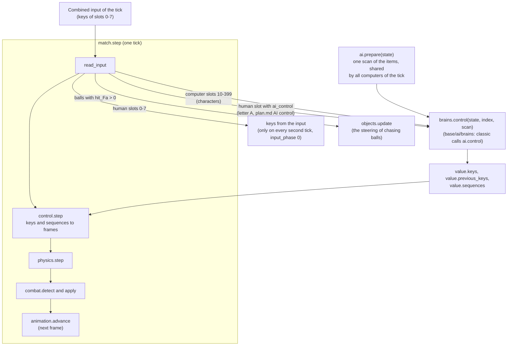
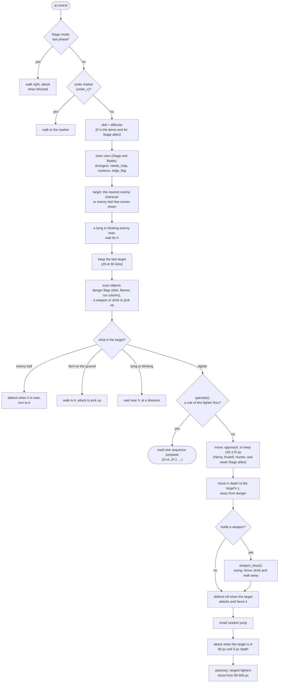
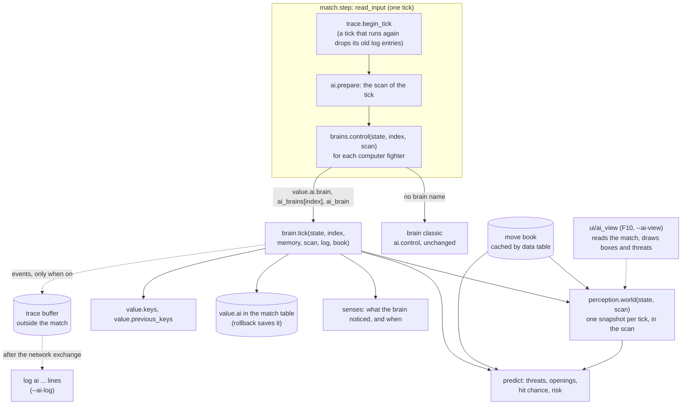

# The AI of the computer fighters

This document describes the AI that OpenLF2 has today. It has two parts:

- The classic AI: a port of the original game's routines for computer fighters. It plays every computer fighter unless a developer option picks another brain. The sections from "Summary" to "Cost" describe it.
- The AI framework: the brain registry, the move book, perception, prediction, the AI log and the development view (docs/ai-plan.md phases 1 to 3). The section "The AI framework" describes what is built.

docs/ai-plan.md is the plan for the rest of the work. docs/ai-moves.md lists the moves of every fighter.

## Summary

- One module holds the whole AI: scripts/base/game/ai.lua (about 1200 lines).
- The AI runs inside the fight simulation, once per tick for each computer fighter, before the keys move the fighters.
- It has no memory of its own. It keeps one field (`last_target`) and otherwise reads the fight state again on each tick.
- It decides with fixed distance rules and random rolls. The difficulty only changes how often a roll succeeds.
- It writes the same key fields that a human player fills. For most special moves, it marks the input sequence as complete and does not type `D>A` key by key.
- It must stay exact: the original's recordings (.lfr) and the demo run the AI again on replay, so every random call must stay in the same order.

## Where the AI runs

`match.step` (scripts/base/game/match.lua) runs one tick of a fight. The function `read_input` runs first. It fills the keys of the human fighters from the input, and it calls the AI for each computer fighter. Then the tick moves the fighters with these keys.

- `read_input` calls the brain registry (base/ai/brains). A fighter without a brain name uses the brain `classic`, which calls `ai.control` without a change (docs/ai-plan.md phase 1).
- `ai.prepare` lists the used slots and the living characters once. `ai.control` adds the target lists to this scan the first time that it needs them (`target_lists`). A ball that steers (`objects.update`) clears the scan, so the next computer scans again.
- Human keys change only on every second tick (`input_phase` 0). The AI writes keys on every tick.
- A human fighter goes to the AI when the letter `A` is in its keys (`read_control` in match.lua). The letter `P`, or a fresh key press after 30 ticks, gives it back.

## What the AI sees

The AI reads the match table directly. It has no separate view of the world, no reaction delay and no limit on what it sees.

| Source | Fields that the AI uses |
|---|---|
| Itself (`S`) | `x_int`, `z_int`, `y_int`, `vx`, `facing`, `frame`, `hp`, `mp`, `dark_hp`, `max_hp`, `team`, `weapon`, `held_item`, `blocked_*`, `follow`, `last_target` |
| Other fighters | position, `vx`, `frame` and its `state`, `hp`, `team`, `blink`, `facing`, `record.id` |
| Objects | John's disk (`john_ball`) by frame group, Firen's flames, Freeze's ice column, weapons and drinks on the ground |
| The fight | `mode`, `difficulty`, `random_game` (the demo), `stage_bound`, the stage width and depth limits, `stage_run.last_phase` |
| Frame data | only a few fixed frame numbers per fighter (for example Firen 255-261, Woody 271) and one frame field (`hits.j == 290` for Davis) |

The AI does not read hit boxes (`itr`), body boxes (`bdy`), move costs or move lengths from the data. Each rule has fixed numbers for the distance and the mp.

## How the AI decides

`ai.control` is one long function with labels and `goto`, in the order of the original. The diagram shows the main path.

The parts of the decision:

- Target choice. The AI takes the nearest enemy by `|dx| + |dz|`. An enemy ball counts when it moves toward the AI. A lying or blinking enemy in 250 px becomes a target to wait for. The last target stays with a chance of 29 in 30.
- Danger. John's disk, Firen's flames and Freeze's ice column set the flags `left`, `right`, `deeper` and `shallower`. The movement rules then do not walk into them.
- Team view. In Stage and Battle mode, the AI looks at its allies: is it the strongest, does an ally need help, must it be careful. These flags decide which drink it picks up.
- Specials. `specials()` holds one block for each fighter. Each block is a list of rules: a distance window, an mp minimum, sometimes the target's state, and a random roll. The first rule that fires marks one sequence and ends the tick.
- Basic play. The AI walks to the target, matches the depth, rolls for a defend, a jump or an attack, and ranged fighters shoot from a distance.

The specials of each fighter in `specials()`:

| Fighter | Rules (short form, with the move names of docs/ai-moves.md) |
|---|---|
| John | DvJ heal self at low hp, D^A biscuit, D>J force field against an enemy with mp at 100-500 px, D^J heal a weak ally near (`help_ally`) |
| Deep | continues the sword combo in frames 260-289, D>J dash sword at a dizzy target, DvA jump sword near |
| Henry | D^J flute near, D>J super arrow from 100-550 px, DJA five arrows from 100-160 px |
| Rudolf | D^J disappear or DvJ clones at a distance, D>J jump sword and D>A from 100-160 px |
| Louis | D>J thousand-foot kick from 81-129 px, D^J catch at less than 45 px, jump out of a catch |
| Firen | D^J explosion near a weaker target, D>J burn run from 100-370 px (steers it in depth, defend stops it), DvJ flame from 60-280 px |
| Freeze | D^J whirlwind near, D>J down punch from 61-279 px, DvJ ice sword at a distance without a weapon |
| Davis | DvA many punch in 280 px, D^A uppercut near a dizzy target, jump to follow a target in the air |
| Woody | DvA in 280 px, D^A on a falling or dizzy target, D>J flying crash from 61-279 px, DvJ teleport to a distant ally at low hp, D^J teleport |
| Dennis | DvA many foot near, D>J whirlwind kick from 75-370 px, D^A chase ball |
| Mark, Jack, Sorcerer, Monk, Jan, Bat, Justin, Julian, Louis EX, Firzen | one block each with the same pattern |

The labels in `specials()` do not always name the input. `heal` and `heal_up_jump` start D^J, `up_jump` and `up_attack` start D^A, `toward` and `toward_by_x` start D>J, `down_jump` starts DvJ, `down_attack` starts DvA, and `by_side` starts D>A.

`attacks()` adds the ball of the ranged fighters (John, Henry, Louis, Dennis, Woody, Davis, Freeze, Firen, Jack, Sorcerer, and Deep with other distances). It presses defend when the target is 100-900 px away in the same depth. On a later tick, in the defend frame, it presses the direction and attack. This is the only place where the AI types a special move key by key.

## What the AI writes

The AI writes only fields of its own fighter. control.lua reads them on the same tick.

| Field | Meaning |
|---|---|
| `keys.up` ... `keys.defend` | the keys held on this tick. The AI clears them first (`copy_and_clear`). |
| `previous_keys.KEY = false` | makes a held key count as a fresh press (`fresh`). A fresh left or right twice is a run. |
| `sequences[i] = complete` | starts the special move of sequence `i` at once (constants.combo_indices: 1 `D>A` right, 2 `D>A` left, 3 `D^A`, 4 `DvA`, 5 `D>J` right, 6 `D>J` left, 7 `D^J`, 8 `DvJ`, 9 `DJA`). control.lua still checks the frame field and the mp. |
| `last_target`, `order_x`, `order_z` | the memory of the target, and the order marker (cleared on arrival) |

## Difficulty

`skill` is `state.difficulty` (constants.difficulties: crazy -1, difficult 0, normal 1, easy 2), with a minimum of 0. A larger skill makes each roll less likely. For example, the close attack rolls `random(skill * 3 + 3) == 0`: a chance of 1 in 3 on Difficult and 1 in 9 on Easy. The demo, the fighters of a random game, and the allies of the players in Stage mode always use skill 0.

## Rules that the AI must follow

- Determinism. The AI uses only `engine.random`, the shared random stream. Every computer of a network game runs the same AI on the same ticks and must get the same keys.
- Rollback. The AI keeps its memory in the match table (`last_target` on the fighter), because a rollback saves and restores only the match table (base/game/rollback).
- Order of random calls. The original's recordings and the demo replay the AI. A new random call, or a call in another place, changes the replay. The comment at the top of ai.lua says this.
- Paths that the scripts do not use today: `order_x`, `order_z` and `follow_order` are never set outside item.lua, and they stay for parity with the original.

## Cost

A headless run of 3000 fight ticks with 5 computer fighters took 3.9 s with the AI and 2.8 s with an AI that returns at once (debug build, best of 3 runs). That is about 0.07 ms for each computer fighter and tick, and part of it is the extra fighting that the AI causes. The AI scans all targets and objects for each computer, so the cost grows with the square of the fighter count.

## The AI framework

The framework lets a fighter use another brain than the classic AI, and it gives a brain the knowledge and the tools to play well. Phases 1 to 3 of docs/ai-plan.md built it. No brain uses it to fight yet: the brains `idle` and `sentry` are test brains.

### One tick with the framework

### Modules and where their state lives

The place of each piece of state decides whether the framework stays deterministic and rollback-safe.

| Module | Role | State and where it lives |
|---|---|---|
| scripts/base/ai/brains.lua | the registry, picks the brain of each fighter, starts a brain's memory | `value.ai` (the memory) and `state.ai_brain`, `state.ai_brains` in the match table: a rollback saves them and the hash covers them |
| scripts/base/ai/random.lua | the AI random stream (Park-Miller) | one integer `memory.rng`. The start of a brain takes one value from `engine.random` |
| scripts/base/ai/move_book.lua | the moves of a fighter from its frames | a module cache by data table: fixed data, never copied by a rollback |
| scripts/base/ai/perception.lua | one snapshot of the fight for each tick | the scan of the tick (`scan.world`): rebuilt on every tick, never kept |
| scripts/base/ai/senses.lua | the reaction record of a brain | three short arrays in the memory |
| scripts/base/ai/predict.lua | threats, openings, hit chance, risk | none: pure functions |
| scripts/base/ai/trace.lua | the debug side channel and the AI log | a module buffer outside the match. Brains write it and never read it |
| scripts/base/ui/ai_view.lua | the development view | a module switch. It only reads the match |
| scripts/base/ai/brains/*.lua | `classic`, `idle`, `sentry` | their memory in `value.ai` (none for classic) |

### The brain interface

A brain is a table `{name, version, start, tick, describe}`. The comment at the top of brains.lua is the reference.

- `start(state, index, seed)` returns the memory. The memory holds numbers, short strings and short arrays only, never a table of the move book or of the snapshot, because a rollback copies the memory.
- `tick(state, index, memory, scan, log, book)` writes the keys of the fighter for this tick. `log` is nil unless the trace follows this fighter. `book` is the move book of the fighter.
- `describe(memory)` gives a short text for the fight description (`ai=NAME/TEXT`).

The brain of a fighter is the first of: the name in its memory, `state.ai_brains[index]`, `state.ai_brain`, `classic`. Today only `--ai-brain` sets the last two, and only for local fights.

### The move book

`move_book.get(record)` reads the frames of a fighter once. For each special and basic move, it has the cost, the length in ticks, the first and last hit, the recovery, the damage, the reach, the projectiles, the follow-up inputs and tags. A timeline gives each tick of the move its frame, its hit boxes (relative to the fighter), its body and its forward distance. For each frame, the book has a class (free, moving, attacking, air, defending, hurt, falling, lying, dizzy, caught, catching, frozen, recovering, busy), the ticks until the fighter is free, and its place in a move (`move_at`). An attacking frame that no move reaches from its start gets a fragment. A move ends where its chain reaches a free frame, 999, 1000, a hold or a loop, the same rule as tools/lf2_moves.py. The books of all 23 fighters take 11 ms in a debug build.

### Perception and prediction

`perception.world(state, scan)` builds one snapshot for each tick. An entry has the position, the speed, the frame class, the ticks until free, the move and its timeline index, the body and hit boxes in world coordinates, the rest timers of combat, and the holder of a held weapon.

`predict` answers four questions:

- `threats`: which attack, flying object or held weapon hits a fighter, and in how many ticks. It follows the combat rules that block a hit (the attack rest, the pair rest, the blink, weak hits on a falling fighter). An attacker moves from its current speed by the `dvx` and `dvy` of its frames, with gravity and ground friction.
- `opening`: how many ticks a fighter cannot act.
- `hit_chance`: whether a move that starts now hits a target, on which tick, and whether the target can act before it.
- `risk`: how much damage an enemy can do if a move misses.

The test brain `sentry` measures the prediction. Over 8 seeds of 3000 ticks with classic attackers, 133 of 143 hits from hit boxes had the exact tick predicted, 1 was 1 tick away and 9 were missed. Grabs (base/game/grab) and the landing after a throw hurt without a hit box, and prediction does not cover them yet.

### The actuator and the difficulty

- base/ai/difficulty has five rows (easy, normal, difficult, crazy, superhuman): reaction ticks, the input rate, key changes a second, timing errors, distance noise, attention, the think interval. The match option `ai_level` picks a row, or the game difficulty does.
- base/ai/actuator types key programs at that rate and is the only writer of a brain's keys. It reads `value.sequences` and types only the keys that a waiting sequence still needs. The drill brain proves that it starts every special move of every fighter (tools/ai_drill_check.py).

### Logs and the development view

- `--ai-log [all|INDICES]` writes `ai t=TICK i=ITEM ev=...` lines. The classic brain writes `ev=target`, `ev=move` and `ev=sum`. The sentry writes `ev=threat` and `ev=hurt`. A fight that can roll back writes a tick 32 ticks later, so that no rollback can change it.
- `--ai-view` or F10 draws the body boxes, the hit boxes, the path of flying objects, the frame class with the ticks until free, and the ticks to the next threat over each fighter.
- The fight description shows `ai=BRAIN/DETAIL` on a fighter with a brain other than `classic`.

### Limits of the framework today

- Perception has two rules: `can_hurt` (combat: another team, and a held weapon has its holder's team) and `enemy` (the classic AI's rule for targets, where players of different teams are not enemies in Stage mode).
- Grabs, throws and the catch moves (`catch` hit boxes) are not threats in the prediction.
- A brain other than `classic` can play only in local fights (`--ai-brain`). The setup screen and network sessions do not offer brains yet, and such a fight makes no recording.
- Positions and speeds are numbers with a fraction, like the physics of the game. A brain must turn them into whole numbers before it compares scores, so that small differences between platforms do not change a decision.
- Phase 4 fixed the bugs that a review found: the team of a held weapon, gravity for thrown items, turns (a negative `next`), reused slots in the senses (objects now keep their spawn tick, `born`), and the restart of a brain when the fighter's record changes or the computer takes a human fighter again.
- `base/game/rollback` shares the fields `record`, `records`, `stage`, `view`, `capture` and `last_snapshot` at any depth. The memory validator (`brains.validate`, on with `--rollback-check`) stops a fight whose brain memory uses such a name or breaks the other rules of docs/ai-plan.md.
- The snapshot reuses a pool of tables. A chasing ball still makes the next brain fill it again, but without new tables.
- `tools/test-ai.sh` runs all AI checks in about 6 seconds: the classic descriptions against tools/ai-tests/, the rollback check every 9 ticks with idle and sentry brains (VS and Stage mode), `--net-sim`, the move book, and the prediction rate.

## Tools that help with the AI today

| Tool | What it gives |
|---|---|
| `--headless --input-trace ... --seed N` | a repeatable fight without a window, and the state of each item at the end (`describe`) |
| The setup screen in a trace | attack on the computers row adds a computer (AGENTS.md has a VS trace) |
| `--rollback-check`, `--net-sim` | proof that the AI state survives a rollback and is the same on two clients |
| The letter `A` in a trace (`#27`, then `=control_0`) | the AI plays player 1, and the description shows `computer=1` |
| The input timeline panel (V) | the keys of this computer's first player over 5 seconds |
| The damage chart and the fight HUD | the damage share and the hp of each fighter |
| Recordings and replays | a fight again, with the same AI decisions |
| `--ai-log [all\|INDICES]` | the AI log: a line for each new target and each special move, and a summary every 30 ticks (docs/ai-plan.md "Logs for agents") |
| `--ai-brain NAME[,INDEX=NAME]` | another brain for the computer fighters of local fights, for example `idle` or `11=sentry` |
| `--ai-view`, F10 | the development view of the AI over the fight: hit boxes, body boxes, frame classes, threats |
| `--ai-book [all\|ID]` | the move book of the AI as log lines (base/ai/move_book), which `tools/lf2_moves.py FOLDER --check LOG` compares with the data files |
| tools/lf2_moves.py | the move list of every fighter from the data files (docs/ai-moves.md) |
| tools/ai_prediction_check.py | the accuracy of the predicted threats in a sentry's log |

The game has no inspector of a brain's decisions yet, and no way to run many AI fights and count the results. docs/ai-plan.md adds them.

## How to change the current AI

The classic AI must stay exact for the replays. Change it only to fix a bug of the port. For new behavior, write a new brain (docs/ai-plan.md).

1. Find the rule in ai.lua: `specials()` for a special move, `weapon_keys()` for weapons, `attacks()` for ranged fighters, `ai.control` for the target and the movement.
2. Keep the order of the `random` calls. If a fix removes a call, the fix changes the replays.
3. Run a fight with computers from a trace, with a fixed `--seed`. Compare the description before and after the change.
4. Run the same trace with `--rollback-check`. The failures must be 0.
5. Play an original recording with `--replay FILE` and make sure that it does not stop with `replay_error`.
6. Run tools/test-online.sh, because the network tests run fights with computers.
