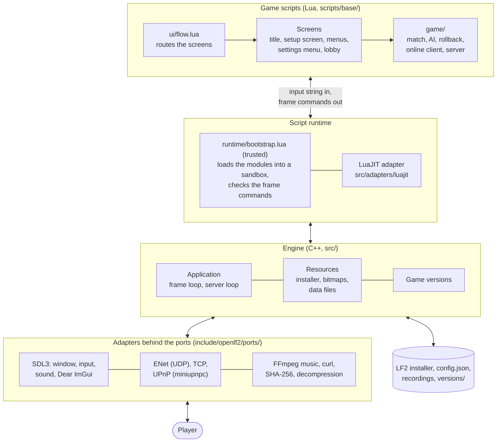
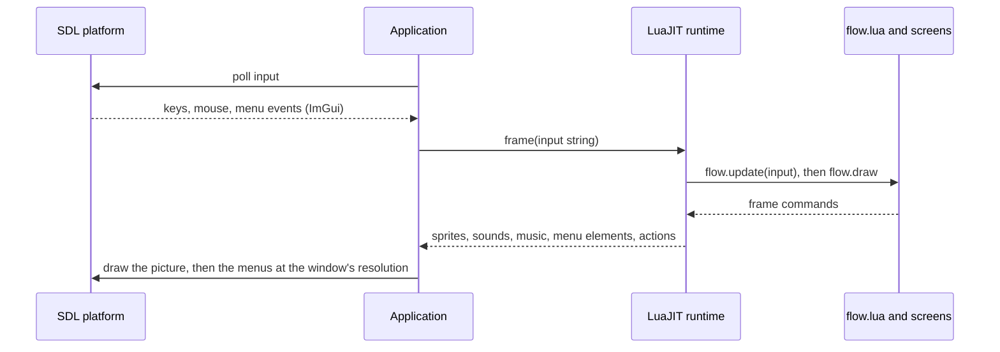
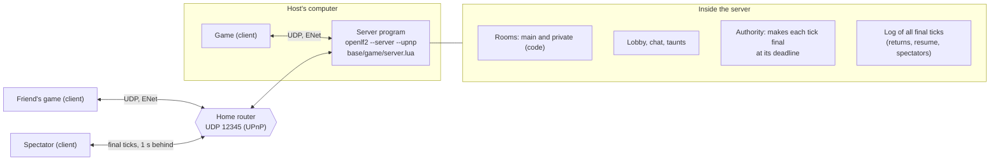
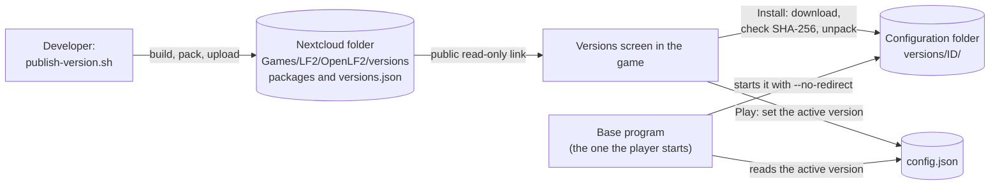

# Architecture of OpenLF2

OpenLF2 reimplements Little Fighter 2 v2.0a. A C++23 engine opens the window, reads the original game data and runs the frame loop. Lua scripts hold the game: the fights, the AI, the modes and the menus. This document shows how the parts fit together. The details are in these documents:

- docs/netcode.md: the network game (prediction and rollback, the server, drops, rooms, spectators).
- docs/ui-network-architecture.md: how the menus and the network game share one model.
- docs/pregame-ui-redesign.md: the match setup screen and the settings menu.
- docs/network.md: the old two-computer TCP game.

## The parts

- The engine knows no game rules. Each frame, it passes the input to the scripts as a string, and the scripts return frame commands: sprites, text, sounds, music and menu elements. The engine draws and plays them.
- The adapters sit behind small interfaces (the ports). A port has another adapter on another platform, for example a stub for UDP in the web build.
- bootstrap.lua is trusted. It loads the game modules into a sandbox that has no files, no operating system and no native code, only the `engine` table. A mod or a network peer can send scripts, but never bootstrap.lua or the engine.
- The game data comes from the original installer, which the engine reads in memory and never runs.

## One frame

- A frame runs every 33 ms, as in the original. The game speed setting skips fight ticks; it does not change the frame time.
- Headless runs (`--headless --input-trace`) run the same scripts without a window. The tests use them.
- A frame of a network game can wait for the server. The engine then runs the scripts again with the same input, so code before the network exchange must not count frames.

## Determinism

Everything that changes a fight must be the same on all computers: the keys, the speed and the random numbers. The keys come through the combined input of a tick, and the random numbers come from the shared generator (`engine.random`). The menus, the music, the overlays and the settings are local to each computer. The rollback code saves, restores and hashes the whole fight state, so two computers can compare their states.

## The network game

- The host's game starts the server program on the same computer and joins it like any other client. The server opens the port on the router with UPnP and stops when the host's game ends.
- The server does not run the game. It collects the keys, makes each tick final at its deadline (it never waits for a slow player), and sends the final ticks to every client. Every client runs the whole game on these ticks.
- The menus run in lockstep on the final ticks. The fights run with prediction and rollback: a client runs ahead with predicted keys, and it goes back and runs the ticks again when a final tick differs.
- The clients send a hash of their fight state every 30 ticks, and the server compares them.
- A player who drops holds the game until the room role decides. A returning player, a spectator and a resumed session get the log of final ticks and run them again to catch up.

## Game versions

- `versions.json` lists the published versions, newest first: the id, the commit, the changes, and for each platform the download address, the size and the SHA-256 checksum.
- Each build has the address of `versions.json` built in, through the public link of the folder.
- The base program starts the active version. All versions share the same configuration, controls and recordings.
- Two computers play together only with the same version: a different build has a different network profile, and the server refuses it.

## The source folders

| Folder | What it holds |
| --- | --- |
| src/app | The application (arguments, frame loop, server loop) and the game versions. |
| src/adapters | SDL3, LuaJIT, ENet and the TCP transport, UPnP, curl, FFmpeg, SHA-256, decompression, and stubs for the web build. |
| src/resources, src/core, src/engine | The installer reader, the bitmaps and data files of the original, JSON and settings, packages. |
| include/openlf2/ports | The interfaces of the adapters. |
| scripts/runtime | bootstrap.lua, the trusted part of the scripts. |
| scripts/base/game | The fight (match, objects, combat, AI), the rollback, the network (server, online client, authority, ticks), the setup model, music and options. |
| scripts/base/ui | The flow and the screens: launch, title, setup screen, classic menus, settings menu, lobby, chat, overlays. |
| tools | The online tests (test-online.sh, test-online-ui.sh) and helper scripts. |
