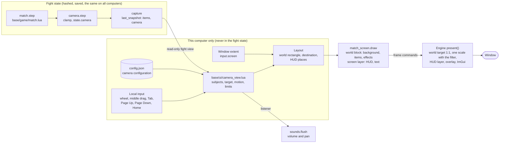

# Camera design

This document designs a modern camera for the fights. Each player sets it for their own screen: how much of the stage it shows, how close it zooms in, and whom it follows. The camera only draws. It never changes the fight state, so it cannot cause a desync (a difference in the fight state between two computers) in a network game. The original camera stays as the classic mode, and it matches the original exactly. A first version of the dynamic camera is built (see "What is built (first version)" under "Implementation steps"). The rest of the design stays open. The study of the current camera describes the code before the first version.

## Goals

1. Show more of the stage on wide and large screens, from 4:3 to 21:9.
2. Keep every fighter that matters on the screen, also with 8 fighters and in Battle mode.
3. Move smoothly: no jumps, no shaking, no zoom that pumps in and out.
4. Let the player tune it: the widest view, the closest zoom, the smoothing, whom to follow, and manual zoom and pan during a fight.
5. Stay local: the camera of one computer never changes the fight on another computer, in a recording or in a replay.
6. Keep the classic mode exact, so that the original picture is always one setting away.

## The current camera

### The fight's camera

base/game/camera.lua holds the camera of the original. `camera.step` runs once per fight tick, in match.step after the weapons and before the capture of the picture (base/game/match.lua:857).

- It first runs `clamp` (camera.lua:38-80). `clamp` is a fight rule, not a camera rule: it keeps items inside the stage and removes balls and dropped items past the stage edges.
- The target is the mean x of the living human fighters, with a look-ahead of 130 pixels in the direction that each fighter faces (camera.lua:82-99, `constants.camera_motion`). A lying fighter has no look-ahead.
- A local game counts slots 0 to 3 only. A network game counts all 8 human slots (camera.lua:88).
- If no human fighter lives, the target is the mean of all living characters. If none lives, the target is x 800.
- The view is always 794 pixels wide (`constants.screen.width`). The target stays inside the stage and below `camera_limit` (camera.lua:104-108).
- The motion is integer arithmetic: `step = ((target - camera) / 14 + step * 6) / 7`, with a minimum step of 1 pixel (camera.lua:109-114).
- The replay viewer pans the camera with the left and right keys (`replay_pan`, match.lua:262-280, camera.lua:115-120).

### What is fight state and what only draws

The rollback code (base/game/rollback.lua) saves, restores and hashes the whole match table, except the fields in `shared_keys` (rollback.lua:11-18).

| Data | Where | Hashed | What uses it |
| --- | --- | --- | --- |
| `camera`, `camera_step` | match table | yes | the classic picture, the sound volume and pan, the replay pan |
| `camera_limit` | match table | yes | the classic camera in Stage mode (`bound - 794`, stage.lua:194) |
| `stage_bound` | match table | yes | fight rules: the clamp of the players, the AI (ai.lua:791), the spawns (stage.lua:112), the weapons (weapons.lua:197) |
| `replay_pan` | match table | yes | the replay viewer (replays are never played over the network) |
| `sound_queue`, `sound_order` | match table, from a tick to its flush | yes | the sounds of the tick, with their volume from `camera` (sounds.lua:40-57) |
| `last_snapshot`, `view`, `capture`, `stage` | match table | no (`shared_keys`) | the picture and the animation counters of the background |
| `follow_camera`, `follow_motion`, `wide_camera` | match screen state | no | the network camera and the wide layout (drawing only) |

No fight rule reads `camera`. The AI, the spawns and the clamp read `stage_bound` and the stage width. As a result, a client camera can differ between computers without a desync. The fight's own camera must stay in the match table, because the classic mode, the sounds and the replay pan use it, and because both computers compute it the same way.

### Rules of the original that the camera touches

- The width 794 is part of fight rules: `camera_limit = bound - 794` (stage.lua:194), the facing of a new enemy (stage.lua:128), and the default stage width (weapons.lua:198). These rules stay as they are.
- Stage mode spawns enemies 150 to 450 pixels past the bound and past the left edge (stage.lua:109-115). The classic view never shows these places.
- A new stage sets the camera back to 0 (stage.lua:143).
- The sound of an item has two "ears" 200 and 600 pixels right of the camera. A sound has full volume within 200 pixels of an ear and is silent at 400 pixels (sounds.lua:31-43). Sounds far from the camera are silent.
- The HUD (the head-up display: the status frames, the scoreboard and the text lines) fills the band from y 0 to 128. The battlefield is clipped to y 128 to 550 (match_screen.lua:688). A high jump disappears behind the band.
- All 12 backgrounds of the installer start their layers at y 128 or 129. The stage widths are 794 (HK Coliseum), 1500, 1600, 2400 and 3200 (Lion Forest). Lee on Road is 2400 wide. We measured this with a headless run of the background preview.

### The drawing

base/ui/match_screen.lua draws the picture that the last tick captured (`screen.snapshot`, match_screen.lua:85-113). `screen.draw` (match_screen.lua:625) has three cases:

- Classic: the 794 x 550 picture at `snapshot.camera`. Every sprite is drawn at `x - camera`.
- Network follow: `follow_step` (match_screen.lua:557-623) runs the motion of the original again, but on this computer's fighters only (flow.lua:871-874). When all of them are down, it follows another living character, and Tab moves to the next one. It runs once per fight tick (match_screen.lua:190 and 236).
- Wide (the "expand" battlefield layout, options.lua:9): the window edges in viewport units come from the engine (`input.screen`, flow.lua:785-789). A window of the full screen width scrolls across the stage at the classic scale and always holds the classic 794 view (match_screen.lua:636-683). base/game/background.lua continues the layers past their ends as mirror images (`continue_layer`, background.lua:128-145). In Stage mode, the area past the bound is clipped to black.

### The engine

src/adapters/sdl/platform.cpp draws a frame like this (`present`, platform.cpp:752-828):

1. The scripts set a viewport of 794 x 550 units. SDL letterboxes it into the window (logical presentation).
2. The draw commands go 1:1 into a texture of the viewport size, or of the `render_area` size in the wide layout.
3. The texture is scaled to the window with the filter of the player: nearest, linear or xBRZ (frame_upscaler).
4. The overlay commands draw over the whole window, letterbox bars included. Then Dear ImGui draws the menus at the window's resolution.

A sprite command has integer x and y in the range -8192 to 8192, a horizontal `scale_x` and `translate_x`, but no vertical scale (include/openlf2/ports/platform.hpp:50-64). The engine has no mouse wheel and no middle button in its input. The frame loop runs at 33 ms, and the game speed skips fight ticks.

## Shortcomings of the current camera

- Wide screens: the classic mode adds black bars. The wide layout shows more, but the scale is fixed by the height of 550: 978 world pixels on a 1920 x 1080 screen, 1304 on 2560 x 1080, and nothing more on a 4:3 screen. The player cannot zoom.
- Fighters far apart: the camera follows the mean, not the extent. Two players at x 200 and x 2000 on Lion Forest put the view at 703 to 1497, and both are off the screen.
- Many fighters: with 8 fighters or Battle mode, the mean hides most of the fight. Computer fighters do not count while a human lives, and soldiers never count.
- Network play: the follow camera shows only this computer's fighters. The opponent is often off the screen, and Tab works only when all of this computer's fighters are down.
- Sound in network play: the sounds use the shared camera of all humans, not the follow camera. The fighter on the screen can be silent.
- Spectators: a spectator has no fighter. The view follows one character at a time and has no overview.
- Replays: the replay viewer pans left and right only, at the classic width, through the fight state.
- Motion: the camera moves on fight ticks only. At game speed 0.4, it stands still on most frames and then jumps.
- Height: high jumps go behind the HUD band, and the band takes 128 of the 550 rows on every screen size.
- Pixel quality: the whole picture is drawn at the viewport resolution and then scaled. A zoomed-out view drawn into this texture loses detail before the scale.
- Stage mode: the wide layout paints the area past the bound black, so the screen looks broken while a section is closed.
- Control: the layout is a choice in the launch screen only (launch.lua:202). The settings menu in a fight (base/ui/fight_menu.lua) has no camera page.

## What players expect

Modern 2D fighting and brawler games (Smash-like platform fighters, team brawlers, local party games) agree on these behaviors:

- The camera zooms to fit all fighters that matter, between a closest zoom and a widest view.
- It moves smoothly. A dead zone (a small area in which movement does not move the camera) stops small steps from moving it. Easing (a gradual start and stop) hides the changes of speed.
- It zooms out fast, so that nobody leaves the screen, and zooms in slowly, so that it does not pump.
- The player chooses whom it follows: everyone, my fighters, one fighter, or a free camera.
- The player can zoom with the mouse wheel or keys, pan with the mouse, and go back to the automatic camera with one key.
- A fixed classic mode matches the original exactly.
- The picture fills screens from 4:3 to 21:9 without stretching.
- Pixel art stays sharp: integer scaling when the player wants it, and a sharp, smooth scale otherwise.
- The HUD stays readable and in place at every window size, and it does not cover the fight.
- Split screen is an option for local players who are far apart.
- The camera stops at the stage edges, and in Stage mode it shows where the closed area begins.
- Battle mode with many soldiers runs at full speed.

## The design

### The main idea: two cameras

The fight keeps its own camera. base/game/camera.lua stays as it is, `state.camera` stays in the match table, and the hash does not change. A second camera, the view camera, lives in base/ui and only draws. The player picks the camera mode:

- `classic`: the original. The picture is exactly the picture of today.
- `wide`: today's expand layout, unchanged (more stage at the classic scale).
- `dynamic`: the new camera. It zooms and pans in floating point, once per drawn frame.

### Where the state lives

- The view camera state lives in the match screen state (`state.camera_view`), next to `follow_camera` today. It never goes into `state.match`. As a result, rollback.save does not copy it, rollback.hash does not see it, and the recordings do not hold it.
- The new module base/ui/camera_view.lua owns the state and the rules. No module in base/game requires it. A test with grep makes sure that this stays true.
- The camera reads the fight through a read-only fight view: the last snapshot and a few match fields. It never writes to them.
- The server program never runs the camera, because flow.draw returns at once on the server (flow.lua:551).

### The fight view

The camera needs these values each frame. All come from `last_snapshot` and the match table, and none is written:

- For each item: `index`, `x`, `y`, `z`, `facing`, `hp`, `human`, `team`, `record.kind`, and the frame (for the state "lying" and the picture height). The snapshot has all of these today.
- The stage: `width`, `zboundary`, and the background row (Lee on Road).
- Stage mode: `stage_bound`, `stage_run.id` and `stage_run.phase`, to find a new stage or a new section.
- `camera` and `replay_pan.active`, for the replay viewer.
- From the flow: this computer's slots (`follow` today), the spectator flag, and the pause.

### How the dynamic camera picks its view

The camera runs once per drawn frame (33 ms), also on frames without a fight tick. It works in world units: x along the stage, and the picture row y, which is `z + y` of an item as the classic picture draws it.

1. Subjects: the camera collects the fighters to show (see "Whom to follow"). Each subject has a priority: high for the fighters that the player must see, low for the others.
2. Boxes: each subject gives a box. The box is 80 units wide around `x`. Its top is the top of the picture of the current frame. Its bottom is `z + 10`. A look-ahead of 48 units moves the box in the direction that the fighter faces, like the 130 of the original but smaller, because the view is wider.
3. The target box: the union of the boxes of the high subjects. The low subjects join if the result still fits in the widest view.
4. The floor band: the target always holds the band from `zboundary[1] - 100` to `zboundary[2] + 20`, so the fighters' feet and the ground stay on the screen.
5. Margins: the camera adds a margin of 12 % of the view width on each side and 24 units at the top.
6. Size: the width is the largest of the box width, the box height times the aspect ratio of the destination, and the closest zoom. The widest view then limits it.
7. Place: the center is the center of the box. The camera keeps the view inside the open area when the view is narrower than the area. When the view is wider than the area, it centers the area.
8. Motion: the camera moves its center and its width toward the target with the rules of "Motion".
9. Hard limit: after the motion, the view grows at once if a high subject is outside the view. This is the only jump, and the margins make it rare.

### Motion

- The center and the zoom each use a critically damped spring (a smooth motion that stops at the target without overshoot). The zoom works on the logarithm of the width, so that zooming in and out feel the same.
- Start values: the center reaches the target in about 0.25 s. The zoom out takes about 0.3 s, and the zoom in about 0.9 s. The smoothing setting scales all three times.
- Dead zone: the center does not move while the center of the target stays in the middle 20 % of the view.
- Hysteresis (a gap between the values that start and stop a change): the zoom changes only when the target width differs from the current width by more than 10 %.
- Snaps: the camera jumps to its target without motion at the start of a fight, at a new stage (`stage_run.id` changes, because stage.lua:143 moves everyone to the left), and at a new round.
- Rollback: the camera reads the predicted state, like the follow camera today. The spring hides a correction of a few pixels.
- Pause: the automatic camera stands still while the fight is paused. The manual zoom and pan still work, so a player can look around.
- The camera has no shake of its own. The original only jitters the sprite of a hit item (`view.shake`), and that stays.

### Whom to follow

The configuration key `camera_follow` has these values:

- `auto` (the default): in a local game, the high subjects are the living human fighters, and the low subjects are the computer fighters in slots 10 to 17. In a network game, the high subjects are this computer's fighters, and the low subjects are all other fighters in slots 0 to 19. Soldiers and stage enemies (slots 20 and up) are never subjects. Without a living high subject, the camera follows the low subjects.
- `everyone`: all living fighters in slots 0 to 19 are high subjects.
- `mine`: only this computer's fighters, as the follow camera today.
- `one`: one fighter. Tab moves to the next living fighter.

Tab works in every case. It cycles through "everyone", then each living fighter, then back. A short text names the fighter, as today (match_screen.lua:697-701). A spectator starts with `everyone`.

Fighters outside the view (possible with `mine`, `one`, or a view at its widest) get an indicator at the edge of the destination: a small arrow in the team color with the player name.

### Manual zoom and pan

- The mouse wheel multiplies a manual zoom factor. The automatic target is multiplied by this factor, and the limits still apply.
- A drag with the middle mouse button pans the view. The view then stays where the player put it (the free camera).
- Page Up and Page Down zoom with the keyboard. Home goes back to the automatic camera and sets the manual zoom factor to 1.
- In the free camera, the automatic camera takes over again after 5 s without a pan, or at once with Home.
- The camera ignores a key that a player uses in the controls (`controls.current().sets`). Tab, Page Up, Page Down and Home are not in the default controls.
- These inputs are local, like `input.screen` (flow.lua:784). They never go into the keys that a network game sends or that a recording saves.

### Aspect ratio and height

- The camera keeps the aspect ratio of the destination rectangle. Nothing is stretched.
- The art of every background starts at y 128 and ends at y 550. Above 128, the camera can show up to 200 units of sky. The engine stretches the top row of the first opaque layer upward for it (a sprite with a vertical scale, see "The engine"). The view never goes below y 550.
- If the view needs more height than the art and the sky give, the destination gets less height instead. The bands above and below it hold the HUD and the text lines. On a 21:9 screen this does not happen, and on a 4:3 screen it happens only at wide views.
- Examples with the HUD band: on 1920 x 1080, a 1300 unit view fills the width at a scale of 1.48. On 2560 x 1080, a 1600 unit view fills the width at a scale of 1.6.

### Stage edges and Stage mode

- The open area is the stage, from 0 to the stage width. In Stage mode with a bound, it is 0 to `stage_bound`.
- When the view is narrower than the open area, the view stays inside it. This matches the classic camera, which stops at the edges and at `camera_limit`.
- When the view is wider than the area (HK Coliseum is only 794 wide), the area is centered. The background continues past the edges as mirror images (`continue_layer`), with a dark fill over it, so that the player sees where the wall is. The configuration key `camera_edges` picks `dim` (the default), `mirror` (no dark fill) or `black`.
- In Stage mode, the area past the bound uses the same dark fill instead of black. When the bound grows, the area grows, and the camera moves into the new area with its normal motion.
- A wider view can show the places where Stage mode spawns enemies. This is only information on one screen, and it does not change the fight. The dark fill makes clear that this area is closed.

### The engine: world blocks

The engine gets a world block: a group of draw commands in world coordinates, drawn into their own texture and scaled once into a destination rectangle.

- New frame command (opcode `world_view`, after `ui` in src/adapters/luajit/runtime.cpp:245-248 and scripts/runtime/bootstrap.lua:167): `context.world_view(x, y, w, h, dx, dy, dw, dh, filter)` starts a block. `x, y, w, h` is the view rectangle in world units, with fractions. `dx, dy, dw, dh` is the destination in viewport units, which can reach into the letterbox bars like `render_area`. `context.world_view()` without values ends the block.
- Inside the block, sprite, fill, text and clip commands use world coordinates. The scripts draw with camera 0. The widest stage is 3200 units (4000 for the scenery of Lee on Road), inside the range of -8192 to 8192.
- The engine draws the block 1:1 into a texture of `ceil(w) + 1` by `ceil(h) + 1` pixels at `floor(x), floor(y)`. Then it scales the part `{x - floor(x), y - floor(y), w, h}` of the texture to the destination at the window's resolution. The fraction gives a smooth pan without a jump of one pixel.
- Order: the engine clears the window with the viewport color, draws the world blocks, then the screen layer, then the overlay, then ImGui. The screen layer is the frame texture of today, cleared to transparent when a block exists, and holds the HUD and the text. A world block is always below the screen layer.
- At most 2 blocks per frame (for split screen). The texture of each size stays cached.
- The projected shadows (`sprite_effects_.prepare`) work per block, with the area of the block.
- A sprite gets `scale_y` next to `scale_x` (platform.hpp:61), for the sky.
- The input gets the mouse wheel (the sum of the frame) and the middle button. The input string gets them next to the `screen` field, and base/ui/controls.lua:276 reads them.
- Headless runs accept the block and count its commands, as today.

### Pixel quality

- The world texture has one texel per world pixel. The engine scales it once, so a zoomed-out view keeps all the detail that the window can show.
- The filter of a block: `nearest`, `linear`, `xbrz` (only at a scale of 2 or more, else `linear`), and a new `sharp`. The `sharp` filter scales with nearest to the largest whole factor below the scale, then with linear to the destination. This keeps the pixels sharp at any scale without the uneven pixels of nearest. It is the default of the dynamic mode.
- The configuration key `camera_integer_scale` rounds the zoom to a whole number of window pixels per world pixel. The zoom then changes in steps: with a destination 1080 pixels high, the world height is 540 at scale 2 or 360 at scale 3.

### HUD and overlays

- The dynamic mode keeps the viewport of 794 x 550 units as the unit of the screen layer, with `render_area` set to the window, as the wide layout does. As a result, the HUD keeps its size and its letterbox scale.
- An offset context (a proxy of `context` like `budgeted` in flow.lua:442) moves the classic HUD commands to their place. The classic band (status frames, scoreboard) sits at the top center of the window. The bottom text line (y `0x213`) sits at the bottom of the window.
- The configuration key `hud_layout` picks `band` or `overlay`. With `band` (the default), the world destination starts below the band. With `overlay`, the world fills the window, and the status frames sit over it in the top corners: players 1 to 4 on the left, players 5 to 8 on the right.
- The configuration key `hud_scale` changes the size of the HUD in steps from 0.5 to 2, after the first dynamic step ships.
- World things stay in the world block: the names, the lives and the HP mark above the heads, the hit sparks, and the ghosts, the combo counters and the particles of base/ui/fight_effects.lua (drawn with camera 0). Names and order markers clamp to the view rectangle instead of the classic screen.
- The stage shutters (stage.lua:179-181) cover the whole destination, as the wide layout does today. The "GO" sprite and the stage texts move with the HUD band.
- The damage chart, the input timeline, the chat and the settings menu stay in the screen layer or in ImGui. Their positions clamp to the window instead of the classic screen.

### Sound

- In the classic and wide modes, the sound stays exactly as today.
- In the dynamic mode, the listener is the view. The ears sit at `left + w * 200 / 794` and `left + w * 600 / 794`, and the two radii grow by `w / 794`. Then all items on the screen are audible.
- base/game/sounds.lua keeps the sums of today for the classic mode and also keeps the x of each sound in its channel. `sounds.flush` gets an optional listener and then computes the volume from the x values. rollback_client.lua:78 gets the listener from a local value that match_screen sets each frame.
- The x list is in the match table only between a tick and its flush, and it is the same on every computer. As a result, the hash stays the same on all computers.

### Split screen

Split screen is an option for local games (`camera_split`: `off`, `auto`). With `auto`, the camera can split the window into a left and a right half. It splits when the high subjects need more than the widest view. The subjects then form two groups, divided at the largest gap in x. Each half has its own view camera and its own world block. The halves join again when the groups need less than 80 % of the widest view. A network game never splits, because each computer has its own screen.

The background counters advance on each paint (background.lua:41-47). With two blocks, the animations play at double speed. As a result, the counters must advance once per frame, in a separate function, before split screen ships.

### Network, spectators and replays

- The camera state is local. The configuration of the camera is local. Two computers with different camera configuration run the same fight and send the same hashes.
- The camera reads the predicted state in a network game, as the follow camera does today. The overlays still read the final ticks.
- A spectator starts with `everyone`, and can use Tab, the wheel and the free camera.
- In a replay, the replay viewer's pan (`replay_pan`, an original rule) still moves `state.camera`. While `replay_pan.active` is true, the dynamic camera targets the center of the classic view, so the left and right keys still pan. The wheel and the free camera also work.
- An optional room limit: the host sets the widest view for a room (for example "classic", "1600" or "whole stage") in the setup (base/game/setup.lua). Clients use the smaller of this limit and their own. This limit is part of the session, not of the fight state. It keeps the information on all screens equal in competitive games.

### The configuration

All keys go into the `options` member of config.json, with defaults and checks in base/game/options.lua (defaults at options.lua:56, checks at options.lua:92 and 159).

| Key | Values | Default |
| --- | --- | --- |
| `camera_mode` | `classic`, `wide`, `dynamic` | `classic` (an old `battlefield_layout` of `expand` becomes `wide`) |
| `camera_widest` | 794 to 4000 world units, or `stage` | 1600 |
| `camera_closest` | 400 to 794 world units | 640 |
| `camera_follow` | `auto`, `everyone`, `mine`, `one` | `auto` |
| `camera_smoothing` | 0 to 100 | 50 |
| `camera_edges` | `dim`, `mirror`, `black` | `dim` |
| `camera_filter` | `sharp`, `nearest`, `linear`, `xbrz` | `sharp` |
| `camera_integer_scale` | true, false | false |
| `camera_split` | `off`, `auto` | `off` |
| `hud_layout` | `band`, `overlay` | `band` |

The settings menu (base/ui/fight_menu.lua) gets a "Camera" page in `pages` (fight_menu.lua:17), with the mode, two sliders ("Show more of the stage" for `camera_widest`, "Zoom in up to" for `camera_closest`), the follow choice, the smoothing, the edges and the filter. A change applies at once, as the sound page does. The launch screen choice "Battlefield layout" (launch.lua:202) becomes "Camera" with the three modes.

### Performance

- The dynamic mode draws only the items whose box touches the view plus 64 units. The classic mode draws all items, as today.
- The world texture is at most about 4000 x 650 pixels, which all renderers accept.
- The released Windows build allows 4096 frame commands. The budget of flow.lua:442-456 drops the commands past the limit, and the HUD comes last. As a result, the dynamic mode must count its world commands against a smaller budget, so that the HUD always fits. We must measure a full Battle mode fight first.
- The camera itself costs a few loops over at most 20 fighters per frame.

### Old engines

A host can send scripts to an older engine. Before the dynamic mode starts, the scripts make sure that `context.world_view` exists. If it does not exist, the dynamic mode falls back to the wide mode. The same check applies to the wheel field of the input.

## Tests

- A frame hash: the headless summary line gets `frame_hash=`, a hash of the draw commands of all frames. The classic mode and the wide mode must keep the same hash through every step of the work. We record the hashes before the first change for a VS fight, a Stage mode run, a Battle mode fight, a replay and Lee on Road.
- A headless window: the option `--window WxH` gives `input.screen` to a headless run, so that the wide and dynamic modes run without a window.
- A description: the match description gets `view=x,y,w,h` (rounded) and `follow=` when the dynamic mode runs.
- A camera check: a developer option `--camera-check` makes the camera test its rules on each frame: all high subjects inside the view or marked by an indicator, the width inside the limits, the view inside the open area. The description shows `camera_check=frames:N,failures:F`. F must be 0.
- Determinism: one trace runs twice, with a configuration of `classic` and with one of `dynamic` (two `--config-dir` folders). The match descriptions must be the same, except `view=`.
- Rollback: `--rollback-check` with the dynamic mode must show 0 failures. `--net-sim` must show 0 hash failures.
- Network: tools/test-online.sh gets a case where the two clients use different camera configurations. Both must print the same state, and the server must log `hashes agree`. The session that owns the ports runs it.
- Pictures: screenshots under Xvfb at 1024 x 768, 1280 x 720, 1920 x 1080, 2560 x 1080 and 3440 x 1440, for a VS fight with 2 and with 8 fighters, Stage mode across a bound, Battle mode, HK Coliseum and Lee on Road.
- Windows: the Windows build in Wine, with the 4096 command limit, in Battle mode.

## Implementation steps

Each step can ship alone and keeps the classic mode exact.

### What is built (first version)

A first version takes a shorter way than steps 3 and 4. It reuses the render area of the engine and does not add the `world_view` block yet:

- The render area takes a drawing origin and a scale (`context.render_area(x, y, w, h, ax, ay, scale)`, Viewport `area_x`, `area_y`, `area_scale`). The engine draws the commands 1:1 into a texture of `w / scale` by `h / scale` and scales it once into the area. The texture keeps spare room, so that a zoom does not make a new texture on every frame.
- base/ui/camera_view.lua frames the human fighters (this computer's fighters in a network game), adds the other fighters below slot 20 when they fit, and zooms out up to the player's widest view (`camera_widest`, 100 to 300 percent of the window), never past the open stage. The motion uses smoothing, with a faster zoom out than zoom in, and it snaps at a new stage.
- The world band keeps the art's rows 128 to 550. A wider view makes the band lower, at the bottom of the classic picture, and the HUD, the texts and the flow's overlays draw over it at the window's scale (`context.overlay(true)`).
- The mode is the third value of the battlefield layout: `dynamic`, next to `classic` and `expand` (Wide). The settings menu's Display page sets it and the widest view. Page Up and Page Down zoom during a fight, and Home goes back to the automatic view.
- Tests: the same trace gives the same fight description with the classic and the dynamic camera, and `--rollback-check` and `--net-sim` pass with it. Without a window (headless runs) the camera uses the classic picture's size.
- An engine without `context.render_scale` (an older engine that gets these scripts) keeps the picture of the classic or the wide layout.
- The probe line of a window (`OPENLF2_PROBE=1`) shows `camera=CENTER,WIDTH,zoom=Z`. The test tools of step 1 (`frame_hash=`, `--window WxH`, `view=`) and `--camera-check` are not built.

The steps below stay the plan for the rest: the sky above row 128, the `sharp` filter, the mouse wheel and middle drag, the follow choices and edge indicators, the sound listener, the HUD layouts, culling and split screen.

1. Test tools. Add `frame_hash=` to the headless summary (src/app/application.cpp:1203), `--window WxH`, and `view=` in `screen.describe` (match_screen.lua:497). Record the baseline hashes. Players see no change.
2. Refactor the drawing. Move the choice of the camera in `screen.draw` (match_screen.lua:625-690) and `follow_step` into base/ui/camera_view.lua, with one result: a view record. The draw functions (`draw_item`, background.paint, fight_effects.draw) take this record. Add the offset context for the HUD. Move the advance of the background counters out of `visible` into a function that runs once per frame. The frame hashes must not change.
3. Engine. Add the `world_view` command, `scale_y`, the `sharp` filter, the mouse wheel and the middle button: include/openlf2/ports/platform.hpp, src/adapters/luajit/runtime.cpp, scripts/runtime/bootstrap.lua, src/adapters/sdl/platform.cpp (`present`, `draw_commands`, `sprite_effects_`), and the headless platform. A developer option draws the classic picture through a block at scale 1, and its screenshot must equal the classic one.
4. The dynamic camera. Write the target, the motion, the limits, the edges, the sky, Stage mode and the HUD band in base/ui/camera_view.lua. Add the keys to base/game/options.lua, the Camera page to base/ui/fight_menu.lua and the choice to base/ui/launch.lua. Add the fallback for old engines. The default stays `classic`. Run the determinism, rollback and network tests.
5. Control. Add the wheel, the middle drag, Page Up, Page Down, Home, the Tab cycle, the follow choices, the edge indicators, and the camera of spectators and replays. Change the Tab code in flow.lua:868-877.
6. Sound. Give the listener of the view to base/game/sounds.lua and to rollback_client.lua:78, for the dynamic mode only.
7. HUD. Add `hud_layout` `overlay`, `hud_scale`, the clamps of the names and markers to the view, and the clamps of the damage chart and the input timeline to the window.
8. Performance. Add the item culling and the separate world budget. Measure Battle mode on Linux and in Wine.
9. Split screen (optional), for local games.
10. The room limit (optional), in the setup and the server (base/game/setup.lua, base/game/server.lua).
11. After feedback from players, decide if `dynamic` becomes the default.

## Open questions

- The default widest view: 1600 units shows half of the largest stage. Players can prefer the whole stage.
- The sky above y 128: a stretched top row works for a plain sky. A stage with a detailed top edge can need a color fill instead.
- The frame loop runs at 30 frames per second. A camera at the refresh rate of the screen needs the engine to draw between frames, which is outside this design.
- The room limit: is it worth the work, or is the same rule for all players enough?
