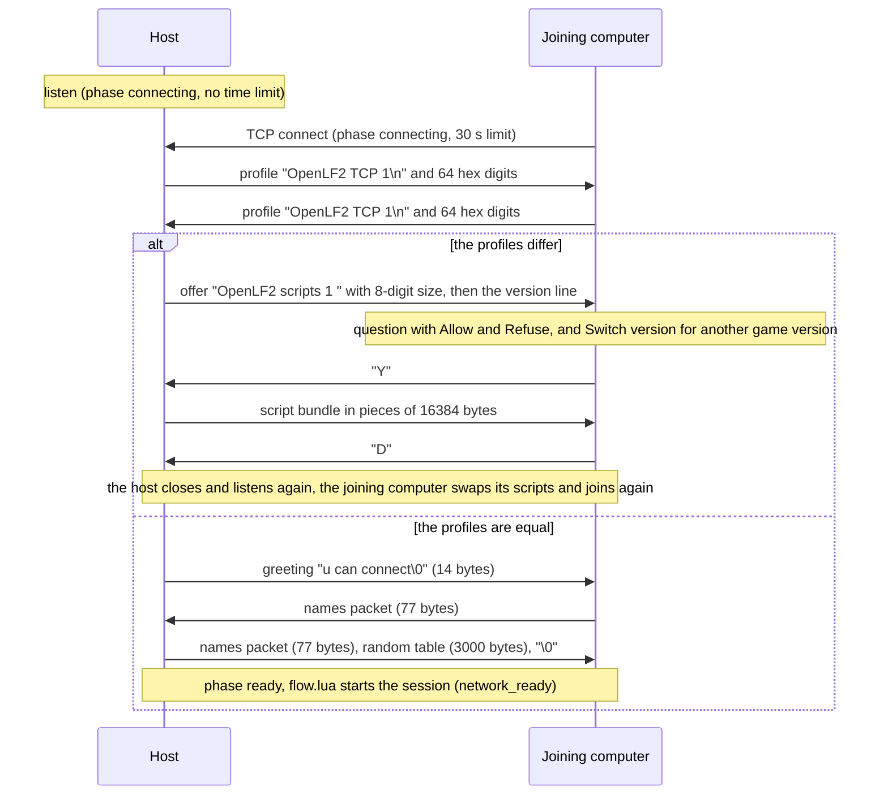

# Network code

This document explains how two computers play one game of OpenLF2 over a network. It is for developers who change the network protocol, the network screens or anything that must stay the same on both computers.

The line references point to the code at commit `99e0cdd` (branch `arena`). Lines move when the code changes, so search for the named function when a reference does not match.

## 1. Overview

A network game connects exactly two computers over one TCP connection. One computer is the host. It listens on a port. The other computer is the joining computer. It connects to the address of the host.

The two computers run the game in lockstep (both run the same frames with the same input). On each frame, each computer sends its keys in a 22-byte packet and waits for the packet of the other computer. Then both run the frame with the combined keys. Nothing else about the game travels over the connection.

The C++ engine moves bytes only. The Lua scripts own the protocol: the handshake, the packet layout, the checks and the lockstep. The comment at src/adapters/luajit/runtime.cpp:395 states this split.

```text
+--------------------------------------------------------------------------------+
| scripts/base/ui/flow.lua       session: network_ready, flow.update calls       |
|                                network.exchange, disconnect, speed menu,       |
|                                input buffer (fight_due), local-only data       |
+--------------------------------------------------------------------------------+
| scripts/base/ui/network.lua    screens: host/join pages, waiting page, share   |
|                                question, version switch, server list, probes   |
+--------------------------------------------------------------------------------+
| scripts/base/game/network.lua  protocol: handshake phases, profile, script     |
|                                sharing, version line, names, random table,     |
|                                22-byte frame packet, checks, network.exchange  |
+--------------------------------------------------------------------------------+
| scripts/runtime/bootstrap.lua  sandbox: engine.network, engine.network_time,   |
|                                engine.scripts, engine.replace_scripts          |
+--------------------------------------------------------------------------------+
| src/adapters/luajit/runtime.cpp  bridge: ops host, join, poll, send, status,   |
|                                  close, argument limits                        |
+--------------------------------------------------------------------------------+
| src/adapters/network/transport.cpp  TCP transport: one peer, nonblocking,      |
|                                     TCP_NODELAY, 64 KiB send queue             |
+--------------------------------------------------------------------------------+
| src/app/application.cpp       command line flags, network profile (SHA-256),   |
|                               frame loop with waiting_network and 1 ms retry   |
+--------------------------------------------------------------------------------+
```

| Layer | File | What it does |
| --- | --- | --- |
| Transport | src/adapters/network/transport.cpp, include/openlf2/ports/network.hpp | Opens, accepts and closes one TCP socket. Queues sends and reads available bytes. Never blocks. |
| Bridge | src/adapters/luajit/runtime.cpp:90-114, 395-414 | Gives the transport to Lua as `engine.network(op, value, port)`. |
| Sandbox | scripts/runtime/bootstrap.lua:58-68 | Puts `network`, `network_time`, `scripts` and `replace_scripts` in the `engine` table of the game scripts. |
| Protocol | scripts/base/game/network.lua | Runs the handshake (`network.poll`) and the frame exchange (`network.exchange`). |
| Screens | scripts/base/ui/network.lua | Shows the network pages and drives `network.poll` until the session is ready. |
| Session | scripts/base/ui/flow.lua | Starts the session (`network_ready`), calls `network.exchange` on each frame and ends the session (`disconnect`). |
| Frame loop | src/app/application.cpp | Runs a script frame again after 1 ms while the frame waits for the network. |

### The transport

The transport serves one peer on the main thread (include/openlf2/ports/network.hpp:13-14). It has four states: `idle`, `listening`, `connecting` and `connected` (network.hpp:12).

- Addresses are numeric IPv4 only. Any other text gives "Network address must be numeric IPv4" (transport.cpp:100-112).
- Each socket is nonblocking and has `TCP_NODELAY`. On POSIX it also has close-on-exec, and `SO_NOSIGPIPE` where the system has it (transport.cpp:82-99).
- `listen` sets `SO_REUSEADDR` (Windows: `SO_EXCLUSIVEADDRUSE`) and uses a backlog of 1 (transport.cpp:116-139).
- When a peer connects, the accepted socket replaces the listener. The listener closes, so a second peer cannot connect (transport.cpp:177-187).
- `send` only adds the bytes to a queue. The queue holds at most 65536 bytes. A larger send fails with "Network send queue exceeds 64 KiB" (transport.cpp:155-160, 242).
- `poll` finishes a pending connect, makes one `send` call for the queue and one `recv` call of at most 8192 bytes (transport.cpp:175-241).
- A `recv` of 0 bytes gives "Network peer disconnected" (transport.cpp:239). Other socket errors give "Network <operation>: system error <number>" (transport.cpp:79-81).
- After an error, `poll` closes the transport (transport.cpp:161-165).

The browser build has a transport without TCP. Each operation there fails with "Direct TCP is unavailable in browsers" (src/adapters/web/transport.cpp).

### The bridge

`engine.network(op, value, port)` takes an operation name, an optional string and an optional port (runtime.cpp:396-414).

| Operation | Result |
| --- | --- |
| `"host", address, port` | Listens on the address and port. Returns `""`, or `nil` and a message. |
| `"join", address, port` | Starts a connect. Returns `""`, or `nil` and a message. |
| `"send", bytes` | Queues the bytes. Returns `""`, or `nil` and a message. |
| `"poll"` | Returns the bytes that arrived (often `""`), or `nil` and a message. |
| `"status"` | Returns `"idle"`, `"listening"`, `"connecting"` or `"connected"`. |
| `"close"` | Closes the socket and clears the send queue. Returns `""`. |

The operation name has at most 16 bytes and the value at most 65536 bytes (runtime.cpp:403). The port must be an integer from 1 to 65535. Without a port argument, the bridge uses 12345 (runtime.cpp:404-405). An unknown operation gives "Unknown network operation".

`engine.network_time()` returns milliseconds of the steady clock of the system (runtime.cpp:442-445). All network time limits use it, never the game frames.

## 2. The connection lifecycle

### How a session starts

A session starts from the command line or from the menu.

- Command line: `--host IPv4` or `--join IPv4`, and `--port N` (application.cpp:419-436). The port is 12345 by default (application.cpp:113). The engine passes `network_role`, `network_address` and `network_port` to the scripts in `runtime_settings` (application.cpp:983-987). Then `flow.create` opens the network screen at once and starts the role (flow.lua:81-86).
- Menu: the launch menu opens the network screen (flow.lua:179-181). Host listens on `0.0.0.0` (`network_bind`, ui/network.lua:144) and on the port of `--port`, or 12345. The screen shows the port as "Your TCP port: N". The menu has no field for the port.

The flag errors are "choose either --host or --join once", "--host needs a numeric IPv4 address" (or `--join`) and "--port needs a number in 1..65535". A recording cannot start with a network role: "a recording cannot be combined with network or preview startup" (application.cpp:477-478). A host that listens prints "Network listening on <address>:<port>" (application.cpp:1000-1002).

`network.create` keeps the session state: the phase, the receive buffer `received`, the sequence number, the frame count, the recording version, the profile and the port (network.lua:108-113). `network.start` resets this state and calls `engine.network("host")` or `engine.network("join")` (network.lua:114-126).

### The sequence



`network.poll` runs the handshake (network.lua:198-303). The network screen calls it once per frame (ui/network.lua:244-261). Each call reads the available bytes into `state.received`, makes sure that the deadline did not pass, and then runs as many phases as the bytes allow. If `state.received` grows past 8192 bytes (`constants.network.max_receive_buffer_bytes`), the call fails with "Network receive buffer exceeded" (network.lua:210-211).

### The phases

Each row is a value of `state.phase`. "Start" means the time of `network.start` for the joining computer, and the time of the connect for the host (network.lua:124, 218).

| Phase | Side | Sends | Expects | Time limit | Errors |
| --- | --- | --- | --- | --- | --- |
| `connecting` | host | nothing, it listens | a peer that connects | none until a peer connects (network.lua:212-216) | socket errors, for example "Network bind: system error N" |
| `connecting` | joining | the TCP connect | the end of the connect | 30 s after start | "Network connection timed out", "Network connect: system error N" |
| `profile` | both | its own profile, 78 bytes (network.lua:217-221) | 78 bytes | 30 s after start | "Network engine/scripts/mod profile mismatch" |
| `offered` | host | the offer header (27 bytes) and the version line (network.lua:227-234) | one answer byte | 120 s (`ask_timeout`) | "Invalid network scripts answer", "The other player refused the scripts or cannot receive them", "Network connection timed out" |
| `await_offer` | joining | nothing | the 27-byte offer header | 5 s | "Invalid network scripts offer", "Network engine/scripts/mod profile mismatch", "Network connection timed out" |
| `ask` | joining | nothing | the answer of the player | 120 s | "You refused the host's scripts", "Network connection timed out" |
| `downloading` | joining | `"Y"` (network.lua:190-195) | the bundle bytes | 30 s after the last chunk | "Network scripts size mismatch", "Network connection timed out" |
| `uploading` | host | the bundle in pieces | `"D"` | 30 s after the last sent piece | "Invalid network scripts answer", "Network connection timed out" |
| `finishing` | joining | `"D"` | the host closes the connection | 5 s, then the swap starts anyway | "Invalid network scripts", "The host's scripts did not load: <reason>" |
| `swapped` | joining | nothing | nothing (the new scripts take over) | none | none |
| `greeting` | joining | nothing | `"u can connect\0"`, 14 bytes | 30 s after start | "Invalid network greeting" |
| `players` | both | Host: the greeting. Joining: its names packet. | a 77-byte names packet | 30 s after start | "Invalid network player assignment" |
| `random` | joining | nothing | the 3000-byte random table and a NUL byte | 30 s after start | "Invalid network random table" |
| `ready` | both | Host: its names packet and the random table | frame packets | 30 s per frame packet (section 4) | section 3 |

A closed socket gives the message of the transport, for example "Network peer disconnected". Two phases replace it with a clearer message (network.lua:205-209). In `await_offer`, the host closes the socket when it cannot offer its scripts, so the message is "Network engine/scripts/mod profile mismatch". In `offered`, the message is "The other player refused the scripts or cannot receive them".

### The profile

The profile is "OpenLF2 TCP 1\n" and 64 hexadecimal digits, 78 bytes in all (network.lua:14, 111). The engine computes the digits as a SHA-256 of three parts (application.cpp:978-981):

- The declarations table of all script modules, as `bundle_source` writes it (src/engine/packages.cpp:202-209). This includes the mods.
- The bytes of scripts/runtime/bootstrap.lua.
- The text `"\nJIT=1"` or `"\nJIT=0"`.

Both computers send their profile as soon as the socket connects. If the profiles are equal, the handshake goes on to the greeting. If they differ, three cases exist (network.lua:226-241):

- The host has `engine.scripts`: it offers its scripts (section 6).
- The joining computer received a profile with the right prefix and only hexadecimal digits: it waits 5 s for an offer.
- Any other case: "Network engine/scripts/mod profile mismatch".

When the profiles are equal, each computer also stores the low 16 bits of the data checksum (`recording.data_checksum() % 65536`) for the frame packets (network.lua:243).

### The names packet

The names packet has 77 bytes (network.lua:88-95):

| Bytes | Content |
| --- | --- |
| 1-8 | The slot assignment as text: `"11110000"` from the host, `"00001111"` from the joining computer |
| 9-32 | 24 `"0"` characters |
| 33-76 | Four name fields of 11 bytes: the name of each local player (at most 10 bytes), filled up with `"_"` |
| 77 | A NUL byte |

The receiver makes sure that bytes 1-8 hold the assignment of the other side and that byte 77 is NUL (network.lua:96-107). Each name ends at the first `"_"` or NUL byte. The host names go to slots 1-4 of `state.names` and the joining names go to slots 5-8.

### The random table

After it reads the names of the joining computer, the host takes its random table (`engine.random_state()`, 3000 bytes), sets it again at index 0 and resets the random sequence (network.lua:284-289). It sends the table after its names packet, with a NUL byte at the end.

The joining computer makes sure that the last byte is NUL and that the table holds no NUL byte (network.lua:292-297). Then it sets the same table at index 0 and resets the random sequence. Both computers now draw the same random numbers.

### Network screen results

The network screen acts on the result of `network.poll` (ui/network.lua:244-261):

- Ready: the joining computer saves the address in its server list. Then the screen sends the action `network_ready`.
- An error on the joining computer within 5 s after a script swap (`network_retry`): the screen starts the join again.
- An error on a host whose peer connected: the host listens again. It shows the message only if the peer sent its profile. A status probe of the server list (section 6) connects and closes at once, so it does not show a message.
- Any other error: the screen goes back to the first page and shows the message.

Escape or the Cancel button closes the connection and goes back one page (ui/network.lua:311-316).

### The start of the session

The action `network_ready` starts the session in `route` (flow.lua:182-200). It sets the same start state on both computers:

- `state.session` holds the network state, and the player names come from the handshake.
- The unlock flags and word trackers reset (`unlock.reset_session`).
- A new title screen opens with its Replay entry disabled.
- The character selection, the championship and the battle setup start empty.
- The stage random list, the demo and the music reset. F5 fast mode goes off.

## 3. The frame packet

`network.packet` writes the packet (network.lua:307-326). This document numbers the bytes from 1, as `string.byte` does. The comment at network.lua:305 names offsets from 0 ("Packet offsets 10 and 12"), which are bytes 11 and 13.

### The bytes

| Byte | Host writes | Joining computer writes | Receiver accepts |
| --- | --- | --- | --- |
| 1-4 | The keys of slots 0-3, `pack_keys + 1` | 1 | An odd value. The host accepts only 1. |
| 5-8 | 1 | The keys of slots 4-7, `pack_keys + 1` | An odd value. The joining computer accepts only 1. |
| 9 | `speed.tenths + 1` (1-11) | 1 | The host accepts only 1. The joining computer accepts 1-11. |
| 10 | The sequence number (0-49) | The same | The same value as its own packet |
| 11 | 1 plus the bits of F1, F2, F4, F5, F6, F7, F9 | The same | An odd value |
| 12 | The recording version | The same | The same value as its own packet |
| 13 | 1 plus the bits of F3, F8 and the unlock words | The same | An odd value of at most 31 |
| 14 | `hp % 100 + 1` | The same | The same value as its own packet |
| 15 | The data checksum, bits 0-7 | The same | The same value as its own packet |
| 16 | The data checksum, bits 8-15 | The same | The same value as its own packet |
| 17-20 | 1 | 1 | 1 |
| 21-22 | 0 | 0 | 0 |

The fields have these sources:

- Keys: each computer reads its local players into `input[0]` to `input[3]`. The packet puts them in bytes 1-4 on the host and in bytes 5-8 on the joining computer (network.lua:311-313).
- Speed (byte 9, OpenLF2 extension): the game speed of the host in tenths (section 5).
- Sequence (byte 10): `(sequence + 1) % 50` for each new packet (network.lua:329). The first packet of a session has 1.
- Recording version (byte 12): the number that the engine reads from the original program (application.cpp:647-658, 987).
- HP (byte 14): `recording.hp_sum` of the match, or 0 outside a fight (flow.lua:605). The sum covers the HP of items 0 to 19 only (recording.lua:163-170, `constants.first_spawned_slot`).
- Data checksum (bytes 15-16): the sum of the token checksums of the words, the objects and the backgrounds (recording.lua:53-65), modulo 65536.
- Fixed bytes (17-22): 1 in bytes 17-20 and 0 in bytes 21-22 (network.lua:309-310).

### The value encoding

Each key byte is the sum of the bits of the held keys, plus 1 (recording.lua:145-160):

| Letter | Key | Bit |
| --- | --- | --- |
| `u` | up | 0x80 |
| `d` | down | 0x40 |
| `l` | left | 0x20 |
| `r` | right | 0x10 |
| `c` | attack | 0x08 |
| `b` | jump | 0x04 |
| `f` | defend | 0x02 |
| none | always set, as in the original | 0x01 |

The function keys use these bits (`function_bits`, network.lua:306). Bit 0x01 of bytes 11 and 13 is always set.

| Key | Byte | Bit |
| --- | --- | --- |
| F1 | 11 | 0x02 |
| F2 | 11 | 0x40 |
| F3 | 13 | 0x02 |
| F4 | 11 | 0x04 |
| F5 | 11 | 0x08 |
| F6 | 11 | 0x10 |
| F7 | 11 | 0x20 |
| F8 | 13 | 0x04 |
| F9 | 11 | 0x80 |

Byte 13 also carries the unlock words (game/unlock.lua:18-22). Bit 0x08 is the word LF2.NET (unlock bit 1, the hidden characters). Bit 0x10 is the word HEROFIGHTER.COM (unlock bit 2, the function keys).

### The checks

`network.exchange` compares the packet of the other computer with its own packet (network.lua:341-355). The first difference closes the connection with one of these messages:

| Test | Message |
| --- | --- |
| Byte 10 differs | "Network sequence mismatch" |
| Byte 12 differs | "Network version mismatch" |
| Byte 14 differs | "Network HP synchronization mismatch" |
| Byte 15 or 16 differs | "Network data mismatch" |
| A byte of 1-8 is even, or a byte of the slots of the receiver is not 1 | "Invalid network input slot" |
| Byte 11 or 13 is even, byte 13 is over 31, byte 9 is out of its range, bytes 17-20 are not 1, or bytes 21-22 are not 0 | "Invalid network packet padding" |

The slot test stops a computer that writes the keys of the players of the other computer.

### The combined input

After the checks, `network.exchange` builds the combined input (network.lua:356-377). Both computers build the same combined input from the same two packets.

- Slots 0-7: the key letters of each slot. Local slots come from its own packet and the other slots come from the packet of the other computer.
- `functions`: each function key that is down on either computer, as digits.
- `function_sources`: the function keys of each computer separately (its own packet first). The fight uses them to latch a key press for each computer (game/match.lua:577-591).
- `speed_tenths`: byte 9 of the host packet minus 1. The host also uses the value from its own packet.
- `unlock_bits`: each unlock word that either computer typed.
- `pointer_x = 0`, `pointer_y = 0` and `button = false`. The packet carries no mouse.
- `keys = {}` and `network = true`. The combined input has no virtual keys, no typed text and no key-down list.

After the exchange, `flow.update` gives the screens the pointer 0, 0 on each frame, and `click` is always false (flow.lua:615-622). As a result, the screens of a network game get no mouse input.

## 4. Lockstep timing

### One frame

`flow.update` calls `network.exchange` once per script frame (flow.lua:599-612). The exchange has four steps (network.lua:327-378):

1. If no packet waits (`state.pending` is nil), it builds the packet, keeps it in `state.pending`, sets a deadline 30 s ahead and queues the send.
2. It calls `network.poll`. The transport writes the send queue and reads up to 8192 bytes.
3. It takes 22 bytes from `state.received`. If fewer bytes arrived, it returns nil, and `flow.update` returns `false`.
4. It runs the checks, builds the combined input, clears `state.pending` and counts the frame (`state.frames`).

TCP has no message limits, so packets of later frames can already wait in `state.received`. Each exchange takes exactly 22 bytes.

When `flow.update` returns `false`, bootstrap.lua returns `false` from the frame before anything draws (bootstrap.lua:258). The engine then marks the frame as `waiting` (runtime.cpp:791-796).

### The frame loop

The windowed frame loop runs a script frame when `FrameClock::due` allows it (application.cpp:1156). `FrameClock` (include/openlf2/engine/frame_clock.hpp) allows a frame when more than 33 ms (`normal_step`) passed since the last scheduled frame. In F5 fast mode the step is 3 ms (`fast_step`). Between two checks the loop sleeps at most 5 ms (`max_sleep`).

A waiting frame changes this (application.cpp:1273-1286):

- The window keeps the last image, and the music keeps playing.
- The loop sleeps 1 ms, reads the window events and runs the script frame again with new input. It does not ask the clock (`waiting_network`).
- Each new try polls the socket once. The packet from the first try stays pending, so the other computer gets the keys from the first try.

The clock does not move while a frame waits. After the wait, `due` lets the next frames run without sleep until the clock is on schedule again. The clock catches up at most 100 ms (`max_lag`).

The headless mode does the same with a trace (application.cpp:1017-1023). It sleeps 1 ms and runs the same trace frame again until the frame does not wait.

### The delay

Local keys go into the packet of the frame on which the scripts read them. Both computers run these keys on that same frame, as soon as the other packet arrives. The game adds no frames of input delay. The wait for the other packet is the delay.

If both computers start a frame at about the same time, each one waits about the one-way trip time of a packet. A trip shorter than 33 ms costs nothing, because the clock waits for the next frame anyway. A longer trip makes each frame take about as long as the trip. In F5 fast mode the step is 3 ms, so each trip longer than 3 ms sets the time of a frame.

### Time limits and closed sockets

A frame fails with "Network input timed out" when the packet of the other computer does not arrive within 30 s after the send (network.lua:331, 336-338). The handshake deadline does not apply in the `ready` phase (network.lua:214).

A closed socket shows on the next poll, that is on the next frame. The transport returns an error such as "Network peer disconnected". `flow.update` then calls `disconnect` with that message (flow.lua:607-608).

`disconnect` closes the connection and opens the launch menu with a clean state (flow.lua:130-144). It clears the session, the player names, the replay unlock flags, the title, the menus and the speed menu. It turns F5 fast mode off. The message shows on the launch menu.

Three local actions end a network game:

- Escape: `flow.update` calls `disconnect` with "Network game disconnected", before the exchange (flow.lua:602-603). If the speed menu is open, Escape closes the menu instead.
- The title Quit: both computers run it on the same frame, because the title runs on the combined input. Each one calls `disconnect` and closes its side (flow.lua:293-298).
- Closing the window: the program ends, and the other computer sees the closed socket.

## 5. Determinism

The fight and the menus run on the combined input. They must give the same result on both computers. This section lists what makes the two computers equal and what stays on one computer.

### What is the same on both computers

| What | How the code makes it the same | Where |
| --- | --- | --- |
| Scripts, bootstrap.lua and the JIT setting | The profile must match before the game starts. | network.lua:222-248, application.cpp:978-981 |
| Game data | Bytes 15-16 compare the data checksum on each frame. | network.lua:243, 318 |
| Random numbers | The host sends its random table. Both set it at index 0 and reset the sequence. A network match resets the sequence again at its start. | network.lua:284-300, game/match.lua:145 |
| The start state of the menus | `network_ready` resets the same state on both computers. | flow.lua:182-200 |
| Player names | Each computer gets the names of the other one. | network.lua:96-107 |
| Keys of the 8 slots and function keys | The combined input carries them. | network.lua:356-368 |
| Game speed | Byte 9 carries the speed of the host. Both use `input.speed_tenths`. | network.lua:316, 369, flow.lua:424 |
| Unlock words | Each computer keeps a typed word until a new packet carries it (`unlock.take_pending`). Then both apply the combined bits. | flow.lua:600-601, 626-636 |
| Frame count | Byte 10 compares the sequence number. | network.lua:329, 342 |
| Fight state | Byte 14 compares the HP sum of items 0-19 on each frame. | network.lua:317, recording.lua:163-170 |

The game camera of a network fight follows the human fighters of all 8 slots (game/camera.lua:85-88). Outside a network game it follows slots 0-3 only.

### What stays on one computer

These parts read local data and never enter a packet. They must not change the match state.

- The pointer image: `flow.draw` draws `pe/lf2_cursor` at the real mouse of this computer (flow.lua:332-386).
- The follow camera: the match screen follows the fighters of this computer (slots 0-3 on the host, 4-7 on the joining computer). Tab picks another one when they are all down. This is drawing only (flow.lua:560-569, ui/match_screen.lua:423-495).
- The damage chart and the input timeline: they get the local mouse before the exchange (flow.lua:555-559). The input timeline watches the first local player (flow.lua:681-685).
- The speed menu window: it opens on the letters M, F, D typed on this computer and uses the local mouse (flow.lua:570-592).
- The volume keys F11 and F12, fullscreen, the battlefield layout and the FPS display.
- The mouse in general. Only the parts above read it. The screens get the pointer 0, 0 and no click on both computers (network.lua:356, flow.lua:615-622).

### The speed menu in a network game

The speed menu works on the local input before the exchange (flow.lua:570-597). The game below keeps running, because both computers must run the same frames. While the menu is open, and until the keys that closed it are let go, the local slots send no keys and no function keys.

Only the host can change the speed. The joining computer opens the menu as locked (`speed_menu.create(not state.session.host)`). It shows the speed of the host from `speed.network_tenths` (flow.lua:613, ui/speed_menu.lua:165).

### The input buffer at slow speeds

Below speed 1.0, `fight_due` decides on which frames the fight runs (flow.lua:401-475). It works on the combined input, after the exchange. In a network game it uses `input.speed_tenths`, the speed of the host (flow.lua:424). As a result, both computers skip the same frames and queue the same keys.

The buffer works like this:

- On each frame, `speed_progress` grows by the speed in tenths. The fight runs when it reaches 10, or when F4 is down.
- Each change of the keys of a slot goes in a queue with its frame number. A change at most 1 frame (`merge_frames`) after the previous one merges into it, so keys pressed together stay one state.
- A merge that erases a change (a press and release in two frames) adds a new entry instead, so a short tap still counts.
- More than 3 states (`state_queue_limit`) in a queue merge the two oldest.
- Each fight frame that reads keys takes the oldest state of each slot.
- Function keys of skipped frames go to the next frame that runs.

## 6. Script sharing and version switching

Script sharing is an OpenLF2 extension (network.lua:10-13). When the profiles differ, the host offers its scripts. The joining player decides. If the player allows it, the joining computer runs the scripts of the host in memory and joins again.

### The offer

The host builds the bundle from `engine.scripts()` (network.lua:227-234). `engine.scripts` returns a copy of the declarations that run now (bootstrap.lua:41-48). It never includes bootstrap.lua or the engine.

The bundle has this format (network.lua:55-62):

- A line with the number of declarations.
- For each declaration, four fields: the operation (`module`, `replace` or `extend`), the target module, the chunk name and the source. Each field is a line with its length and then its bytes.

If the bundle is over 16 MiB (`share_limit`), the host fails with "Network engine/scripts/mod profile mismatch". Else it sends the offer: "OpenLF2 scripts 1 ", the size as 8 digits and a newline (27 bytes). If the host knows its own game version, the version line follows in the same send.

### The version line

The version line is "OpenLF2 version <version>\n" (network.lua:21-23). The version comes from `engine.build_label`, which has the form "OpenLF2 <version> (<commit>)" (network.lua:24-27). Older joining games ignore the line.

The joining computer reads the line in the `await_offer` and `ask` phases (network.lua:28-38). The version must use letters, digits and `. _ + -`. If more than 65 bytes follow the prefix without a valid line, the joining computer stops waiting for it and sets `host_version` to `""`.

### The question

The joining computer tests the header and the size (1 byte to 16 MiB). Then it enters the `ask` phase and the screen shows a question (ui/network.lua:374-399):

- "The host wants to send its game scripts (N KB)." and "Do you allow it?".
- The buttons Allow and Refuse. Refuse has the focus first. Escape also refuses.
- If the host names a version that differs from the own version, and this engine has `engine.versions`, the question also shows "The host runs version X, you run Y." and a third button, Switch version (ui/network.lua:35-42).

Refuse fails the session with "You refused the host's scripts" and closes the socket. The host then sees "The other player refused the scripts or cannot receive them" and listens again.

### The transfer

Allow sends `"Y"`. The host enters `uploading` and the joining computer enters `downloading` (network.lua:250-256, 190-195).

`share_poll` moves the bytes (network.lua:131-177). One call makes up to 32 rounds per frame. Each round does two things:

- The host offers the next piece of 16384 bytes (`share_piece`). If the send queue is full, the transport refuses the piece, and the host offers it again in the next round.
- The computer polls the socket once. The joining computer adds the received bytes to its chunks.

The screens show "Sending scripts: N%" and "Receiving scripts: N%". Each sent piece and each received chunk moves the deadline 30 s ahead. More bytes than the offered size fail with "Network scripts size mismatch".

When all bytes arrived, the joining computer sends `"D"` and enters `finishing` with a 5 s limit. The host closes the connection on `"D"`. It listens again on the same address and shows "Scripts sent. Waiting for the other player to join again" (network.lua:149-155).

### The swap

The joining computer starts the swap when the host closes the socket, or after 5 s (network.lua:178-188). `decode_scripts` makes sure that the bundle has 1 to 4096 declarations, valid operations and the exact length (network.lua:63-87). A bad bundle gives "Invalid network scripts".

Then `engine.replace_scripts(declarations, changes)` runs (bootstrap.lua:128-159). The `changes` are these keys:

| Key | Value |
| --- | --- |
| `network_role` | `"join"` |
| `network_address` | The address of the host |
| `network_port` | The same port |
| `network_profile` | The profile that the host sent |
| `network_retry` | `true` |

`replace_scripts` does these steps:

1. It makes sure that the list has 1 to 4096 entries and that each entry has a valid operation and three strings.
2. It copies `runtime_settings` and takes from `changes` only the five keys of the table above (bootstrap.lua:133-134).
3. In a protected call, it builds a new module loader, loads `base/ui/flow` and `base/i18n/i18n`, and calls `flow.create` with the new runtime settings.
4. On an error it returns `false` and the message. The running scripts stay, and the session fails with "The host's scripts did not load: <message>".
5. On success it keeps the new modules in `pending_swap`. The next frame switches to them before it runs (bootstrap.lua:175-178).

The new scripts live in memory only. Nothing goes to disk, and a restart brings back the own scripts. The screen says "They replace your scripts until you restart the game."

The new `flow.create` sees `network_role = "join"` and joins the host again. Because of `network_retry`, the screen tries the join again on each error during the first 5 s (ui/network.lua:146, 251-253). This covers the time that the host needs to listen again.

In the second handshake, the joining computer sends the profile of the host, so the profiles match. This second handshake does not compare bootstrap.lua or the JIT setting of the two computers. The scripts of the host run on the engine of the joining computer. This is why scripts must test new engine functions before they use them (`if engine.versions then`).

### Version switching

Switch version installs and starts the version of the host (ui/network.lua:178-214, 232-239):

1. The joining computer closes the connection and shows "Switching to version X".
2. If the version is not installed, it reads the version list ("Reading the version list...") and downloads it ("Downloading..." with a percentage).
3. It calls `engine.versions("launch", id, address, port)` and shows "Restarting the game...".

The bridge adds `--join <address> --port <port>` to the arguments of the new program (runtime.cpp:82-85). src/app/versions.cpp:340-363 saves the version as the active version and queues the program with `--no-redirect`. The frame loop then starts the program and the old program exits (application.cpp:1340-1347).

The new program joins the host from the command line. If its profile matches, the normal handshake runs. Escape during the steps gives "Switching canceled.". A failed step shows its message on the first page.

On the host, the closed connection gives "The other player refused the scripts or cannot receive them", and the host listens again.

### The server list

The join page keeps a list of servers in config.json under `network_servers` (ui/network.lua:43-99). Each entry has an address and a favorite flag.

- The list holds at most 8 entries and the page shows 5. Favorites come first.
- A successful join moves the address to the front of its group. When the list is full, the oldest entry that is not a favorite goes.
- A click on a row joins that address. A click on its star changes the favorite flag.
- While the page is open, the screen probes each shown server in turn (ui/network.lua:104-132). A probe connects, waits at most 1500 ms and closes at once. Each server gets a probe again after 4000 ms.
- Green "waiting for you" means that a host accepted the connection. Red "not hosting" means that it did not.

The probes use the same transport as the game. A waiting host sees the probe as a peer that leaves before its profile, so it listens again without a message.

## 7. How to test

Use headless traces on one computer to test the network code. The commands come from AGENTS.md.

### Run a network trace

1. Build the program:

   ```sh
   cmake --build --preset debug
   ```

2. Set the installer path and a trace. Both programs must use a trace of the same length.

   ```sh
   I=~/.local/share/OpenLF2/LF2_v2.0a.exe
   T=",,#13,,#13,,,,c,,,,"
   ```

3. Start the host in the background. Choose a free port. Do not use port 12345 when a real game hosts on this computer.

   ```sh
   build/debug/openlf2 --headless --installer $I --scripts scripts --seed 1234 --host 127.0.0.1 --port 12461 --input-trace "$T" > host.txt &
   ```

4. Start the joining program:

   ```sh
   build/debug/openlf2 --headless --installer $I --scripts scripts --seed 1234 --join 127.0.0.1 --port 12461 --input-trace "$T"
   ```

5. Compare the state lines of the two programs. They must be equal. For the trace above, both print this line:

   ```text
   network_frames=13 screen=characters menu=0 countdown=150 slots=1:0:0,0:0:0,1:0:0,0:0:0,1:0:0,0:0:0,1:0:0,0:0:0
   ```

`network_frames` is the number of exchanged frames (`state.session.frames`, flow.lua:301). To test a fight, use the VS fight trace and the speed prefix from AGENTS.md on both programs.

### What the trace does

- The handshake runs before the first trace frame. While the network screen is active, `flow.update` returns `false`, so the headless loop runs trace frame 0 again until the session is ready (flow.lua:698-702). The trace then starts on the title screen.
- If the handshake of a headless program fails, `flow.update` raises the error and the program stops (flow.lua:699).
- A frame that waits for the other computer runs its trace frame again (application.cpp:1017-1023). As a result, held keys repeat. The packet from the first try stays pending, so the other computer gets the keys of that trace frame once. The local-only parts of `flow.update` (speed menu letters and unlock words) see the same held keys again.
- The host prints "Network listening on 127.0.0.1:12461" before its trace starts.

A Windows build runs in Wine with the same flags. Pass Windows paths, for example `Z:\home\...`.

## 8. Known limits

- A network game has exactly two computers and four player slots on each. The listener accepts one peer and then closes (transport.cpp:132, 185).
- The address must be numeric IPv4. The join page accepts only digits and dots, at most 15 characters.
- The menu has no field for the port. The port comes from `--port` or is 12345.
- The connection has no encryption.
- The packet holds key states, not key presses. A key that goes down and up while a frame waits does not reach a packet.
- The exchange has no mouse. The screens of a network game get the pointer 0, 0 and no click, so the mouse works on none of them.
- The combined input has no virtual keys, no typed text and no key-down list. A screen that needs them does not work in a network game.
- The only check of the game state is the HP sum of items 0 to 19, modulo 100, on each frame. A difference elsewhere goes unnoticed until it changes this sum.
- Each frame waits for the packet of the other computer. A slow trip slows down the game on both computers. The game has no input delay setting and no prediction.
- A frame fails after 30 s without the packet of the other computer. A closed socket ends the session. The game cannot pause for a dropped player or let a player return.
- Only the host sets the game speed.
- Script sharing allows at most 16 MiB and 4096 declarations. After a swap, the profiles do not compare bootstrap.lua or the JIT setting.
- The browser build has no network game.
- A redesign is planned. [docs/ui-network-architecture.md](ui-network-architecture.md) describes commands in place of raw input, a local UI on each computer and a server program as the authority of every network game. [docs/netcode.md](netcode.md) describes the fight over UDP with prediction and rollback, rooms and chat.

The plan for the next network features (a separate server, drops and returns, AI control, less input delay) is in [plan.md](../plan.md).
